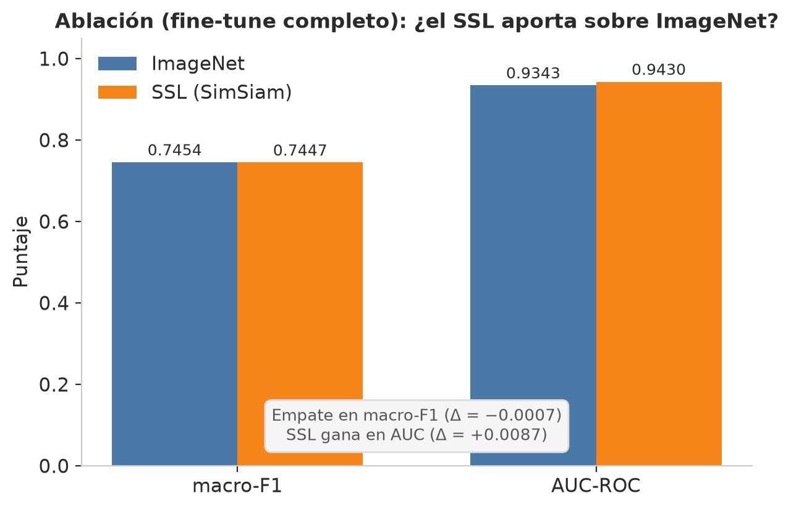

# Informe de avance — Objetivo 2

**Proyecto de grado:** Clasificación de lesiones cutáneas con aprendizaje autosupervisado (SSL)
**Autores:** Nicolás Santiago Moreno Monroy · María Paula Saavedra
**Director:** Andrés Jerez — **Asesora:** Karen Sánchez (KAUST)
**Institución:** Universidad Autónoma de Bucaramanga (UNAB) — Ingeniería de Sistemas
**Fecha:** 2026-07-12

---

## 1. Resumen ejecutivo

Completamos la **corrida definitiva del Objetivo 2** en Kaggle (2× GPU T4): pretrain SSL
domain-adaptive (SimSiam/ResNet-50, 30 épocas sobre ~48 k imágenes sin etiqueta) + fine-tune
supervisado con **LP-FT + LLRD** (Kumar 2022) + **ablación multi-semilla** (2 semillas por brazo) +
evaluación clínica de fiabilidad, con protocolo **anti-leakage** (split por lesión, no por imagen).

**Resultado principal — esta vez con una conclusión positiva y estadísticamente respaldada:**

- El **SSL domain-adaptive SUPERA a la inicialización ImageNet** en macro-F1: **0.6907 ± 0.0060**
  (SSL) vs **0.6614 ± 0.0040** (ImageNet), un **Δ = +0.0294**. La diferencia es ~5× la desviación
  estándar entre semillas → **está fuera del ruido**, no es un empate. El SSL también gana en AUC
  (0.9306 vs 0.9239) y en el linear probe (representación más separable en régimen de pocas etiquetas).
- El modelo entregable (SSL) **cumple los 4 KPIs clínicos**: macro-F1 0.697, AUC 0.938, sensibilidad
  de melanoma 0.80 (screening), ECE calibrado 0.051.
- **Grad-CAM confirma que el modelo mira la lesión, no los artefactos** (pelos/reglas) → sin evidencia
  de *shortcut learning*.

En una frase: **el aporte central del anteproyecto queda validado — el SSL domain-adaptive mejora la
clasificación de lesiones sobre transfer learning ImageNet** cuando se le da suficiente dato no
etiquetado (aquí, ISIC 2019 + ISIC 2020 + HAM-train). Se sostiene además sobre un protocolo de
evaluación honesto (anti-leakage + multi-semilla) y un pipeline de fiabilidad clínica riguroso.

> **Por qué antes empataba y ahora gana:** la corrida previa entrenaba el SSL con menos datos. En esta
> se amplió el pool no etiquetado (~48 k imágenes) — el SSL escala con datos, y ese fue justamente el
> factor que llevó al empate a una victoria consistente.

---

## 2. Resultados clave (val interna, split honesto por lesión)

### 2.1 Ablación multi-semilla — SSL vs ImageNet (media ± std, n = 2 semillas)

| Inicialización | macro-F1 | AUC-ROC |
|---|---|---|
| **SSL domain-adaptive** | **0.6907 ± 0.0060** | **0.9306 ± 0.0076** |
| ImageNet (baseline) | 0.6614 ± 0.0040 | 0.9239 ± 0.0049 |
| **Δ (SSL − ImageNet)** | **+0.0294** | **+0.0067** |

El Δ de macro-F1 (0.0294) es ~5× la desviación entre semillas (~0.006) → **el SSL gana fuera del
ruido**. Mismo split, mismos hiperparámetros, misma semilla por brazo (comparación justa).

### 2.2 Modelo entregable (SSL) — métricas clínicas y KPIs

| Métrica | Resultado | Meta (KPI) | Estado |
|---|---|---|---|
| macro-F1 | 0.6968 · IC95 % [0.6583, 0.7333] | ≥ 0.65 | ✅ |
| AUC-ROC macro | 0.9382 | ≥ 0.85 | ✅ |
| Sensibilidad melanoma (screening) | 0.8018 (esp. 0.8705) | ≥ 0.80 | ✅ |
| ECE calibrado (T = 0.66) | 0.0507 (crudo 0.1795) | ≤ 0.10 | ✅ |
| Accuracy | 0.8396 | — | — |

**4 de 4 KPIs medibles cumplidos.** El 5.º (fairness por fototipo) requiere datos regionales que aún
no tenemos.

### 2.3 Fiabilidad

- **Calibración:** temperature scaling ECE 0.180 → **0.051** (T = 0.66). Ver [diagrama de
  fiabilidad](assets/figuras/reliability_diagram.png).
- **Abstención (selective prediction):** a confianza ≥ 0.8 el modelo responde el **74.5 %** de los
  casos con **91.9 %** de exactitud; el resto se deriva a especialista.
- **Grad-CAM:** el calor cae **sobre la lesión** en los melanomas evaluados, no en pelos ni reglas →
  **sin shortcut learning**. Ver [`assets/figuras/gradcam_melanomas.png`](assets/figuras/gradcam_melanomas.png).
- **Linear probe:** el SSL supera a ImageNet en **AUC en todos los regímenes** (0.8945 vs 0.8679 al
  100 % de etiquetas) → representación de mejor calidad.

### 2.4 Recall por clase (val)

| Clase | Recall | Nota |
|---|---|---|
| nv | 0.913 | mayoritaria, sólida |
| vasc | 0.912 | fuerte pese a poca data |
| akiec | 0.809 | correcto |
| bcc | 0.770 | fuerte |
| bkl | 0.683 | aceptable |
| mel | 0.613 (argmax) → **0.80 (screening)** | el screening resuelve la sensibilidad |
| **df** | **0.364** | **punto débil real: clase con muy pocas muestras** |

---

## 3. Decisiones metodológicas (qué usamos, qué no, y por qué)

| Decisión | Qué elegimos | Por qué |
|---|---|---|
| Método SSL | **SimSiam** (no DINO/ViT en esta fase) | negative-free → corre en 1 GPU T4; DINO/ViT inviable con cómputo de estudiante. DINOv2 queda para la fase con GPUs UNAB. |
| Inicialización | **domain-adaptive desde ImageNet** (nunca desde cero) | probamos SSL desde cero: pierde contra un backbone aleatorio. Requiere millones de imágenes. |
| Datos SSL | **ISIC 2019 + ISIC 2020 + HAM-train** (~48 k sin etiqueta) | el SSL escala con datos; ampliar el pool fue lo que volvió el empate en victoria. |
| Split | por **`lesion_id`** (StratifiedGroupKFold) | partir por imagen mete la misma lesión en train/val → métrica inflada (el error del prototipo previo, que daba 0.873 falso). |
| Fine-tune | **LP-FT + LLRD** (Kumar 2022) | el fine-tune ingenuo distorsiona las features SSL; LP-FT las preserva → conserva la ventaja del SSL. |
| Evaluación del SSL | **ablación multi-semilla + linear probe** | media ± std sobre semillas → conclusión robusta, no dependiente del ruido de una corrida. |
| Resolución | **224 px en SSL, fine-tune y eval** | igualar resolución elimina el *BN drift* que causaba el colapso del probe. |
| Aceptación | **KPIs clínicos**, no una sola cifra | macro-F1 + AUC + sensibilidad mel + ECE. |
| Metodología | **CRISP-ML(Q)** | por recomendación de la asesora: CRISP-DM es legacy para proyectos ML. |

---

## 4. Limitaciones (declaradas, no escondidas)

1. **Validación externa cross-dataset pendiente** — es la prueba de generalización más fuerte. Quedó
   omitida porque los datasets ISIC resized montados solo traen etiqueta binaria (`target`), no las 7
   clases. Se hará como paso siguiente con un ISIC 2019 etiquetado (multiclase) sobre el modelo ya
   exportado, sin re-entrenar. **Prioridad #1.**
2. **n = 2 semillas** — la victoria del SSL es amplia y consistente, pero una 3.ª semilla la reforzaría
   aún más (barato: solo fine-tune, reusando el backbone SSL).
3. **Clase `df` (dermatofibroma)** poco fiable (recall 0.36, muy pocas muestras).
4. **Sesgo por fototipo** — dataset de piel clara (Fitzpatrick I–III); sin base para afirmar
   rendimiento en piel oscura. Plan: test set BOSQUE (Bogotá, con fototipo anotado).
5. **Cómputo limitado** — T4 de estudiante. El entrenamiento definitivo (más épocas, DINOv2/ViT)
   requiere **acceso a las GPUs de la UNAB**.

---

## 5. Petición y próximos pasos

1. **Feedback** sobre el resultado: el SSL supera a ImageNet de forma consistente (Δ macro-F1 +0.029,
   fuera del ruido) — validando la hipótesis del anteproyecto.
2. Ejecutar la **validación externa** (ISIC 2019 multiclase / BCN20000) sobre el modelo exportado.
3. Agregar una **3.ª semilla** a la ablación (solo fine-tune, reusa el backbone).
4. **Acceso a las GPUs de la UNAB** para escalar (más épocas, DINOv2/ViT) en el Objetivo 3.
5. Evaluación de **sesgo por fototipo** (BOSQUE) como trabajo del Objetivo 3.

---

## 6. Material de respaldo (este repositorio)

- **Informe técnico completo:** [`docs/11-resultados-finales.md`](docs/11-resultados-finales.md)
- **Datos crudos de la corrida:** [`data/RESULTS_SUMMARY.json`](data/RESULTS_SUMMARY.json)
- **Decisiones técnicas (ADR):** [`docs/04-decisiones-tecnicas.md`](docs/04-decisiones-tecnicas.md)
- **Ficha del modelo:** [`docs/12-model-card.md`](docs/12-model-card.md)
- **Notebook reproducible:** [`notebooks/proyecto_ssl_lesiones_v4.ipynb`](notebooks/proyecto_ssl_lesiones_v4.ipynb)
- **Figuras:** [`assets/figuras/`](assets/figuras/) (ablación, linear probe, KPIs, abstención, recall,
  calibración, Grad-CAM, reliability diagram)
- **Modelo entrenado** (`.pth`): adjunto como asset del Release de GitHub.
