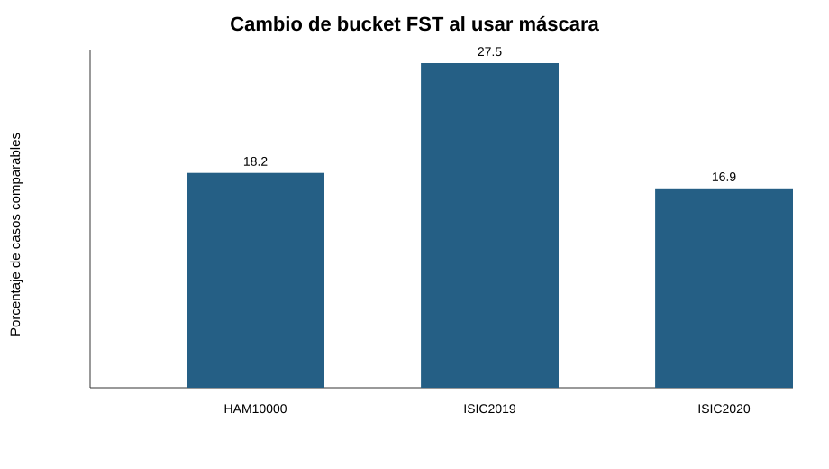
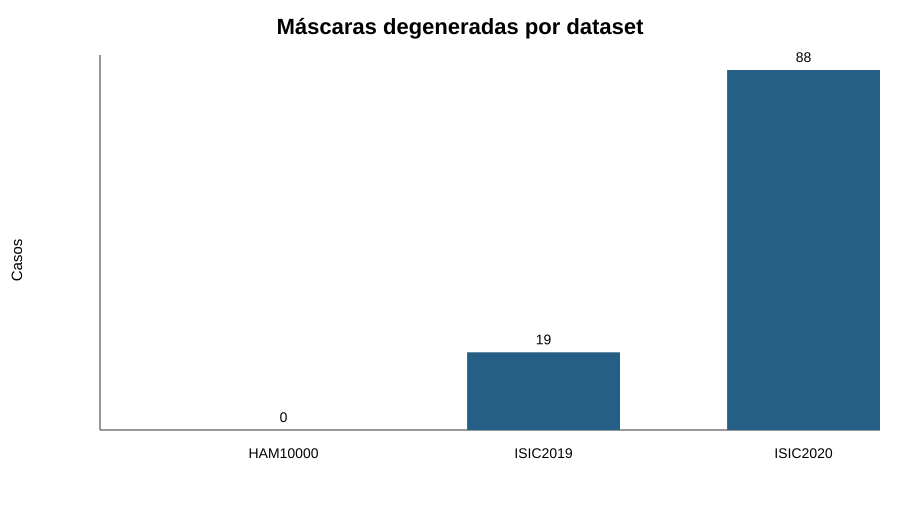

# Informe académico integrado

## Adaptación de representaciones SSL por tono de piel para clasificación de lesiones cutáneas

**Proyecto de grado:** Clasificación de lesiones cutáneas con aprendizaje autosupervisado  
**Autores:** Nicolás Santiago Moreno Monroy y María Paula Saavedra  
**Institución:** Universidad Autónoma de Bucaramanga, Ingeniería de Sistemas  
**Fecha de esta consolidación:** 2026-09-18

## Resumen ejecutivo

El proyecto estudia si las representaciones aprendidas mediante aprendizaje autosupervisado pueden mejorar la clasificación de lesiones cutáneas y, al mismo tiempo, permitir una evaluación explícita del comportamiento del modelo frente a diferencias de tono de piel. La implementación combina un protocolo reproducible de datos, división anti-fuga, estimación del tono mediante Fitzpatrick Skin Type (FST), entrenamiento SSL sin etiquetas clínicas y una propuesta de mitigación mediante CIRCLe.

La conclusión actual debe dividirse en dos niveles. Primero, el diagnóstico FST inicial ya tiene ejecuciones completas sobre HAM10000, ISIC2019 e ISIC2020 con fallback Otsu. La máscara operacional cambia la asignación de bucket en 18,2 %, 27,5 % y 16,9 % de los casos comparables, respectivamente. Después, la corrida V2 con U-Net entrenada durante 20 épocas seleccionó la época 13 como mejor checkpoint, con Dice de validación 0,85538 e IoU 0,74731; con ese modelo, el cambio de bucket fue 12,2 %, 22,1 % y 13,8 %.

Segundo, la infraestructura SSL/CIRCLe está preparada en buena parte, pero Stage 1 y Stage 2 CIRCLe todavía no cuentan con una ejecución GPU real dentro de este checkout. El resumen Kaggle v5 disponible está marcado como smoke y no es válido como resultado de tesis. El proyecto tiene evidencia fuerte de preparación, diagnóstico FST y contratos de ejecución, pero todavía no debe afirmar una mejora de fairness producida por CIRCLe.

## 1. Problema y motivación

Los sistemas de clasificación dermatológica pueden aprender representaciones que funcionan de manera desigual cuando cambia la distribución de tonos de piel. Una métrica global puede ocultar una brecha importante en un bucket FST, especialmente si los grupos están desbalanceados o si el tono se estima de forma contaminada por la lesión, el fondo o la iluminación.

El problema se aborda como una cadena experimental completa:

1. construir un inventario reproducible de imágenes y grupos;
2. evitar fuga entre entrenamiento y evaluación;
3. estimar FST con y sin máscara de lesión;
4. entrenar o evaluar representaciones SSL sin consumir diagnósticos ni FST;
5. medir desempeño global y por bucket;
6. activar CIRCLe solo si Stage 1 demuestra una brecha que merezca mitigación.

## 2. Objetivos

### Objetivo general

Evaluar y preparar una estrategia reproducible de adaptación de dominio por tono de piel para clasificación de lesiones cutáneas mediante representaciones SSL y la técnica CIRCLe.

### Objetivos específicos

- Construir manifiestos de imágenes, hashes, cobertura y splits sin leakage.
- Estimar FST usando una máscara de lesión trazable y una política explícita de cuarentena para máscaras deficientes.
- Comparar representaciones SSL y supervisadas bajo protocolos compatibles.
- Definir contratos JSON para ejecuciones, reanudación, resultados y validez para tesis.
- Medir brechas por tono antes de decidir si CIRCLe debe ejecutarse.
- Dejar un flujo reproducible para smoke, Stage 1 y Stage 2 en GPU.

## 3. Datos y control de fuga

El pipeline utiliza HAM10000, ISIC2019 e ISIC2020. La unidad experimental no es una imagen aislada: se procura conservar agrupaciones por lesión o paciente para evitar que variantes casi idénticas aparezcan simultáneamente en entrenamiento y validación.

El inventario incorpora identificadores, hashes SHA-256, cobertura, grupos de duplicados y un split_hash. Las etiquetas clínicas y los identificadores FST se mantienen fuera del cargador de preentrenamiento SSL. Esta separación evita que la representación aprenda directamente la variable que después se usa para auditar fairness.

## 4. Estimación FST y máscaras

Se implementaron dos lecturas complementarias:

- **Imagen completa:** estima el tono sobre toda la imagen.
- **Imagen enmascarada:** estima el tono usando una máscara de lesión trazable.

La máscara tiene semántica fija: true significa lesión. Las máscaras faltantes, degeneradas o de baja confianza no se usan silenciosamente: se registran, quedan fuera de los casos elegibles o activan un estado explícito de calidad.

### Resultados del diagnóstico FST inicial (fallback Otsu)

La tabla siguiente corresponde al diagnóstico inicial ejecutado sin el manifiesto de máscaras U-Net. Se conserva porque permite cuantificar el efecto de la segmentación como línea base, pero los resultados finales de la corrida U-Net se reportan después en la subsección V2.

| Dataset | Imágenes | Comparables | Cambio de bucket | Cambio relativo | Casos degenerados con máscara | Smoke |
|---|---:|---:|---:|---:|---:|---|
| HAM10000 | 10.015 | 10.015 | 1.823 | 18,2 % | 0 | No |
| ISIC2019 | 25.331 | 25.312 | 6.960 | 27,5 % | 19 | No |
| ISIC2020 | 33.126 | 33.038 | 5.593 | 16,9 % | 88 | No |

### Figuras

Los datos muestran que la máscara no es un detalle cosmético. En ISIC2019 más de una cuarta parte de los casos comparables cambia de bucket; además, 19 casos no son comparables con máscara por degeneración. En ISIC2020 ocurre lo mismo con 88 casos. Estos casos deben conservarse en los reportes de cobertura y no eliminarse para mejorar artificialmente la apariencia de los resultados.

**Aclaración para HAM10000:** el diagnóstico no significa que existan 10.015 segmentaciones U-Net o máscaras persistidas de alta confianza. En el CSV, las 10.015 filas tienen `mask_source=otsu_fallback` y `artifact_con_mascara=false`. Por tanto, HAM10000 tiene una máscara operacional generada por fallback para cada imagen, pero no un artefacto de segmentación independiente. Esta diferencia debe mantenerse visible al comparar los tres datasets.

### Resultados iniciales de ITA, estado de U-Net y contraste con la literatura

Los primeros resultados de ITA que se obtuvieron en el flujo de validación corresponden a una comparación entre la imagen completa y una región estimada mediante Otsu. En esa ejecución, la columna de máscara no representa una segmentación U-Net validada: `mask_source=otsu_fallback` indica que se utilizó el mecanismo de respaldo. Por ello, estos valores deben presentarse como un diagnóstico inicial del estimador ITA, no como el resultado final de la segmentación aprendida.

| Configuración | Exactitud FST | Exactitud con diferencia máxima de un bucket | Lectura |
|---|---:|---:|---|
| Imagen completa, umbrales anteriores | 22,8 % | 52,4 % | Resultado inicial antes de corregir los umbrales atribuidos a Groh |
| Otsu, umbrales anteriores | 29,8 % | 65,5 % | Mejora aparente que no debe atribuirse a U-Net |
| Imagen completa, umbrales empíricos de Groh corregidos | 30,8 % | 66,4 % | Mejora explicada principalmente por la corrección de los cortes |
| Otsu, umbrales empíricos de Groh corregidos | 28,5 % | 65,6 % | La región Otsu no mejora frente a la imagen completa |

La corrección de los umbrales es una decisión metodológica relevante. Los cortes `(55, 41, 28, 19, 10)` correspondían a la referencia clásica de Chardon, pero estaban etiquetados como Groh. El protocolo corregido utiliza los cortes empíricos de Groh `(40, 23, 12, 0, -25)`. En consecuencia, la mejora observada en la configuración de imagen completa no puede interpretarse como una mejora causada por una máscara.

El principal problema observado está en los tonos oscuros. En Fitzpatrick17k-C, la configuración sin máscara recuperó 53,4 % del bucket 6, mientras que la configuración con Otsu recuperó 29,9 %. Además, 145 de 371 imágenes oscuras fueron asignadas erróneamente al bucket 1. Esto es consistente con la hipótesis de que el umbral de luminancia del fallback elimina regiones válidas de piel oscura y deja parches más brillantes. La constancia de color tampoco debe presentarse como solución: en el smoke disponible redujo la exactitud a aproximadamente 5--10 %, frente a aproximadamente 23--30 % sin esa transformación.

#### Qué se puede afirmar sobre U-Net

El pipeline GPU de U-Net se ejecutó durante 20 épocas sobre ISIC2018 Task 1 y luego se utilizó para generar las máscaras del conjunto objetivo HAM10000. El mejor punto de control se obtuvo en la época 13, con `val_dice=0,85538` y `val_iou=0,74731`; por ello, el checkpoint seleccionado no corresponde a la última época, sino al mejor desempeño de validación.

Nota de trazabilidad: la arquitectura implementada es una U-Net clásica de 4 etapas (32/64/128/256 canales, cerca de 7,77 M de parámetros; `src/dermssl/torch_unet.py`), no una DoubleU-Net. Las cifras V2 de esta sección (Dice, IoU, época 13 y cambios de bucket 12,2 %, 22,1 % y 13,8 %) provienen de una corrida en Kaggle cuyo log o JSON no está versionado en este repositorio; por eso no pueden verificarse desde un clon. Los resultados con fallback Otsu sí se respaldan con los JSON locales `resultados_fst_v3_*`, ignorados por git.

| Época | Train loss | Val loss | Val Dice | Val IoU |
|---:|---:|---:|---:|---:|
| 1 | 0,39166 | 0,76241 | 0,56318 | 0,39196 |
| 5 | 0,20702 | 0,23652 | 0,81106 | 0,68218 |
| 10 | 0,17182 | 0,17912 | 0,82838 | 0,70704 |
| 13, mejor | 0,16508 | 0,14631 | 0,85538 | 0,74731 |
| 20 | 0,15337 | 0,15865 | 0,84732 | 0,73509 |

La evolución muestra aprendizaje estable: el Dice aumenta de 0,56318 a 0,85538 hasta la época 13 y luego presenta una leve fluctuación, mientras que la pérdida de validación alcanza su mínimo en esa misma época. La decisión de conservar el checkpoint de la época 13 evita seleccionar el modelo únicamente por haber completado más épocas.

#### Resultado FST V2 después de aplicar U-Net

La corrida V2 produjo registros de comparación para los tres conjuntos. En HAM10000 todas las imágenes quedaron en estado `ok`; en ISIC2019 se excluyeron 19 máscaras degeneradas y en ISIC2020 se excluyeron 88. El cambio de bucket se calculó únicamente sobre los casos comparables.

| Dataset | Imágenes | OK sin máscara | OK con máscara | Degeneradas | Cambios de bucket | Cambio relativo |
|---|---:|---:|---:|---:|---:|---:|
| HAM10000 | 10.015 | 10.015 | 10.015 | 0 | 1.221 | 12,2 % |
| ISIC2019 | 25.331 | 25.331 | 25.312 | 19 | 5.599 | 22,1 % |
| ISIC2020 | 33.126 | 33.126 | 33.038 | 88 | 4.565 | 13,8 % |

Estos resultados V2 reemplazan la interpretación anterior basada exclusivamente en el diagnóstico Otsu. Con el checkpoint U-Net de la época 13, el cambio de bucket disminuye a 12,2 % en HAM10000, 22,1 % en ISIC2019 y 13,8 % en ISIC2020. La máscara aprendida modifica la estimación de FST, pero no debe interpretarse automáticamente como una mejora de exactitud: su efecto debe medirse con validación externa y métricas por bucket.

Esta distinción coincide con la literatura. Alipour, Burke y Courtney reportan una exactitud cercana al 22,9 % para estimar tono de piel mediante ITA bajo condiciones de iluminación no controladas, valor próximo al 22,8 % observado aquí antes de corregir los umbrales ([Alipour et al., 2026](https://onlinelibrary.wiley.com/doi/10.1111/srt.70374)). La coincidencia no demuestra equivalencia entre datasets, pero sí respalda que la fragilidad observada pertenece al estimador y a las condiciones de captura, no únicamente a una implementación local.

El contraste con Fitzpatrick17k-C también debe leerse como validación externa provisional: ese recurso fue construido para estudiar la calidad y la variabilidad de las etiquetas de tono de piel, por lo que sirve para detectar fallos de ordenamiento y sensibilidad por bucket, pero no reemplaza una validación clínica independiente ([Fitzpatrick17k-C, Scientific Data](https://www.nature.com/articles/s41597-025-04382-5)). En conjunto, estos hallazgos justifican ejecutar la siguiente fase con máscaras U-Net reales, umbrales corregidos, control de confianza y reporte separado de cobertura; solo después debe decidirse si la brecha observada requiere la mitigación CIRCLe ([CIRCLe](https://arxiv.org/abs/2208.13528)).

### Decisiones y hallazgos del diagnóstico

- Se documentó el sesgo de Otsu contra piel oscura, especialmente en el bucket 6.
- La constancia de color se probó como hipótesis de mejora y se descartó porque empeoró el ITA en la validación disponible.
- Se agregó validación externa provisional con Fitzpatrick17k-C. Esta sirve como contraste técnico, no como validación clínica definitiva.
- La clasificación FST se reporta con método, máscara, cobertura, confianza y estado de disponibilidad para que una cifra no oculte fallos del pipeline.

## 5. Representaciones SSL y baselines

El protocolo separa el preentrenamiento de la evaluación clínica. Se consideran representaciones SSL, incluyendo DINOv2 y SimSiam, y baselines supervisados como ResNet50 ImageNet. Las comparaciones deben conservar el mismo split, semillas, resolución, backbone congelado y protocolo de probe.

El repositorio contiene resultados históricos de bancos Kaggle y una corrida v5 de smoke. El archivo results/kaggle_v3_download/RESULTS_SUMMARY_v5.json declara explícitamente SMOKE (números NO validos). Aunque su rejilla completa reporta 12/12 ejecuciones sin error y backbone congelado, el gate de sanity kNN no pasa el umbral: AUC 0,794 frente al criterio mayor que 0,80. Por eso esos números sirven para verificar contratos y conectividad del flujo, no para sostener una conclusión experimental final.

## 6. Contratos de ejecución y frescura de resultados

La primera parte del flujo completo implementó contratos para:

- schema_version, run_id y valid_for_thesis;
- hash del pool y del split;
- estados canónicos de las etapas fst, tone_transforms, pretrain, stage1 y stage2;
- identidad única por ejecución Kaggle;
- validación estricta de JSON descargados;
- recuperación de una ejecución interrumpida;
- separación entre staging y directorio final.

Un JSON válido por estructura no es suficiente. También debe coincidir el token de ejecución, el modo smoke/real y el contrato de la corrida actual. Esto evita que un resultado anterior parezca ser la salida de una ejecución nueva.

Los reportes históricos registran 37 pruebas y un skip para Task 1, y 49 pruebas focales para Task 2. Estas cifras son evidencia de los reportes guardados, no una nueva ejecución realizada durante esta consolidación.

## 7. CIRCLe y puerta de Stage 2

CIRCLe no debe ejecutarse automáticamente solo porque el código exista. La decisión de diseño es una puerta por etapas:

1. Stage 1 genera features originales y transformadas, evaluación estratificada y un gate de fairness.
2. Si el gate es PASS o SKIP, Stage 2 se omite y se registra explícitamente como SKIPPED.
3. Solo si Stage 1 devuelve FAIL se ejecutan baseline, regularización CIRCLe y blend sintético con el mismo backbone congelado.
4. Stage 2 debe producir run.json y evaluation.json, con semillas, backend, configuración, métricas por bucket e intervalos de confianza.

### Estado actual

La implementación local contiene piezas de transformación, contratos y un runner de bundle CIRCLe, pero no hay todavía un stage1_results.json ni una ejecución GPU real de Stage 1 o Stage 2 que permita afirmar una reducción de brecha.

## 8. Decisiones metodológicas

| Decisión | Motivo | Consecuencia |
|---|---|---|
| Separar imagen completa y máscara | El fondo y la lesión afectan el ITA | Se reportan cobertura y cambios de bucket |
| Rechazar máscaras degeneradas | Una máscara inválida contamina el diagnóstico | Se conserva un estado explícito de exclusión |
| Excluir FST del preentrenamiento | Evitar fuga de la variable auditada | Fairness se evalúa después, no se inyecta en SSL |
| Mantener gates por etapa | No toda brecha requiere mitigación | CIRCLe se ejecuta solo ante FAIL de Stage 1 |
| Identificar cada corrida con token | Evitar resultados Kaggle obsoletos | Reanudación y descargas aisladas |
| Separar smoke de resultados de tesis | El smoke valida infraestructura | No se presentan cifras smoke como conclusión científica |
| Mantener validación externa separada | ISIC2019 tiene solapamientos y limitaciones | No se declara independencia donde no existe |

## 9. Qué está terminado y qué no

| Área | Estado | Evidencia |
|---|---|---|
| Inventario y splits | Implementado | pool_manifest.py, data_resolver.py y OpenSpec |
| Diagnóstico FST | Ejecutado en tres datasets | resultados_fst_v3_*/*.json |
| U-Net V2 para máscaras | Ejecutado: 20 épocas; mejor checkpoint en época 13 | `val_dice=0,85538`, `val_iou=0,74731`; resultados V2 por dataset |
| FST V2 con máscaras U-Net | Ejecutado | HAM10000 12,2 %; ISIC2019 22,1 %; ISIC2020 13,8 % de cambios de bucket |
| Contratos de experimento | Implementados localmente | experiment_contract.py, run_contract.py |
| Frescura Kaggle | Implementada y reportada | task-2-report.md |
| Stage 1 | Brief y piezas parciales | task-3-brief.md; falta artefacto real |
| Stage 2 CIRCLe | Runner y transformaciones, sin GPU real | kaggle_circle_bundle.py, checkpoint 21 |
| Resultado final CIRCLe | No disponible | No existe evaluation.json real |
| Validación clínica externa | Pendiente | Faltan datos multiclase etiquetados adecuados |

## 10. Limitaciones

- Los datasets redimensionados disponibles no resuelven por sí solos una validación externa multiclase.
- HAM10000 está contenido en ISIC2019; por tanto, ambas evaluaciones no son independientes.
- Las máscaras degeneradas impiden asignar FST en una fracción de ISIC2019 e ISIC2020 y deben incluirse en la cobertura reportada.
- El entorno local no tiene GPU ni sesión Kaggle para ejecutar Stage 1 y Stage 2.
- La corrida v5 disponible es smoke y falla el sanity kNN.
- El preentrenamiento propio multi-GPU requiere resolver los fixes DDP pendientes.
- Cualquier token Kaggle expuesto debe rotarse antes de una nueva ejecución.

## 11. Trabajo futuro

### Prioridad inmediata

1. Implementar el contrato Stage 1 esperado: bundle de siete claves, hashes, stage1_results.json, gate G3 y validez para tesis.
2. Completar pruebas focales, Ruff y validación estática sin GPU.
3. Generar un manifest FST real y ejecutar Stage 1 en Kaggle o en las GPUs de la UNAB.

### Prioridad experimental

4. Si Stage 1 devuelve FAIL, ejecutar el smoke Stage 2 con datos reales.
5. Ejecutar baseline, regularización y blend sintético con mismas semillas, splits y backbone congelado.
6. Reportar brecha global, brecha por FST, EOD, NAR, bootstrap e intervalos de confianza pareados.

### Prioridad académica

7. Completar validación externa multiclase con un conjunto que no comparta las mismas imágenes o lesiones.
8. Resolver DDP, aumentar épocas y evaluar DINOv2/ViT-B en las GPUs disponibles.
9. Rotar credenciales Kaggle, registrar versiones de datasets y congelar los artefactos finales.
10. Presentar al director una tabla de decisiones, una tabla de resultados y una matriz de limitaciones antes de interpretar cualquier mejora como evidencia clínica.

## 12. Conclusión

El aporte actual no es solo un modelo: es un protocolo auditable para evitar que una mejora aparente provenga de leakage, de una máscara defectuosa, de una corrida Kaggle obsoleta o de una comparación estadísticamente débil. El diagnóstico FST ya demuestra cambios sustanciales al pasar de imagen completa a imagen enmascarada.

La hipótesis de mitigación CIRCLe está formalizada y parcialmente implementada, pero la evidencia de reducción de brecha todavía no existe. La siguiente etapa debe completar Stage 1, respetar su gate y ejecutar Stage 2 solo si los datos demuestran una brecha medible. Esa separación entre lo demostrado, lo preparado y lo pendiente es esencial para una presentación académica honesta.

## 13. Organización para el remoto y artefactos locales

Esta sección define qué debe viajar al repositorio y qué debe permanecer local. Preparar un push no significa subir automáticamente todos los archivos generados durante las corridas.

### Candidato para commit y push

| Grupo | Archivos o rutas | Motivo |
|---|---|---|
| Informe | `INFORME_ACADEMICO.md` | Documento académico consolidado en español |
| Figuras | `docs/figuras_analisis/*.svg` | Gráficas reproducibles y livianas del informe |
| Generador | `results/generar_figuras_fst.py` | Permite regenerar las figuras desde los datos resumidos |
| Código reproducible | Scripts, módulos y pruebas modificados que correspondan a la rama V6 | Mantener implementación, contratos y validaciones revisables |
| Especificación | `openspec/changes/fst-domain-adaptation-circle/` y planes aprobados | Conservar decisiones, requisitos y etapas del trabajo |

### Debe permanecer local o fuera del commit normal

| Grupo | Archivos o rutas | Motivo |
|---|---|---|
| Resultados grandes | `resultados_fst_*/`, `results/kaggle_v3_download/` | Salidas generadas; pueden pesar mucho y se regeneran desde el pipeline |
| Entornos de ejecución | `.kaggle-staging/` | Staging temporal específico de Kaggle |
| Paquetes | `*.zip`, incluido `pretrain-v6-bundle.zip` y `fix-kaggle-fst-manifest-glob.zip` | Bundles de transferencia, no fuente canónica |
| Checkpoints | `*.pth`, `*.pt`, `*.ckpt` | Pesados; deben conservarse en almacenamiento de artefactos, no en Git |
| Credenciales y logs sensibles | Tokens, archivos de configuración privados y logs con rutas o credenciales | Riesgo de seguridad y reproducibilidad controlada |

### Etapas del proyecto

| Etapa | Estado | Se puede afirmar actualmente |
|---|---|---|
| FST inicial con fallback Otsu | Terminada | Se identificó la sensibilidad de ITA y el sesgo en tonos oscuros |
| U-Net V2 y FST enmascarado | Terminada | Se obtuvo Dice 0,85538, IoU 0,74731 y resultados por dataset |
| Construcción del manifest y control de calidad | Parcialmente terminada | Hay contratos, confianza y cuarentena; falta congelar el artefacto final V6 |
| Stage 1 del clasificador V6 | Pendiente | Falta la ejecución GPU con evaluación por FST |
| Domain adaptation CIRCLe | Pendiente de ejecución | Falta entrenar regularización y synthetic blend con datos reales |
| Fairness final | Pendiente | Faltan AUC/F1/recall por FST, EOD, NAR, ABROCA y comparación contra baseline |
| Stage 2 y conclusión final | Condicionada a Stage 1 | Solo se ejecuta si el gate demuestra una brecha que requiera mitigación |

La U-Net y el análisis FST ya aportan la medición y la evidencia del problema. La mejora de fairness del clasificador solo podrá declararse después de ejecutar y comparar Stage 1, regularización y synthetic blend bajo el mismo split, semillas y backbone. Los resultados actuales deben presentarse como diagnóstico, preparación y control de calidad, no como resultado final de adaptación de dominio.

## Fuentes internas

- docs/19-resultados-bancos-congelados.md
- docs/20-validacion-externa-fst-fitzpatrick17k.md
- docs/21-checkpoint-manual-circle-stage2.md
- openspec/changes/fst-domain-adaptation-circle/tasks.md
- resultados_fst_v3_ham10000/diagnostico_fst_ham10000.json
- resultados_fst_v3_isic2019/diagnostico_fst_isic2019.json
- resultados_fst_v3_isic2020/diagnostico_fst_isic2020.json
- results/kaggle_v3_download/RESULTS_SUMMARY_v5.json
