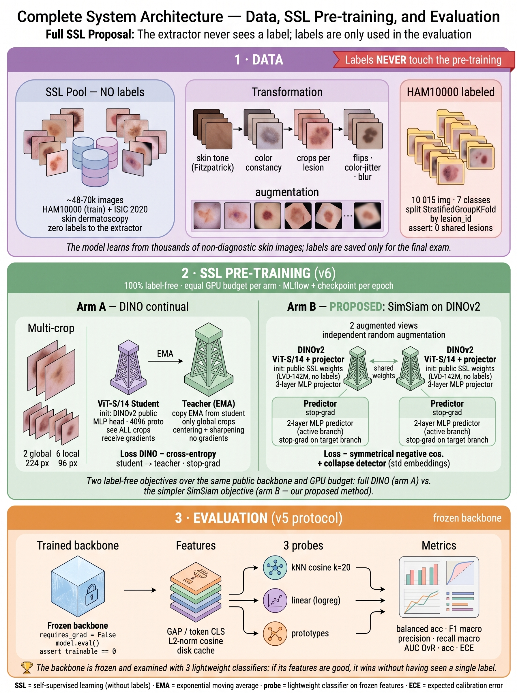

# Proyecto de Grado UNAB — Clasificación de Lesiones Cutáneas con Aprendizaje Autosupervisado (SSL)

> Repositorio privado de trabajo. Documentación, investigación, decisiones técnicas, el pipeline
> que estamos corriendo y las problemáticas abiertas del proyecto.

## Resumen en una línea

Sistema de **apoyo** al tamizaje de lesiones cutáneas basado en **aprendizaje autosupervisado
(self-supervised learning)** sobre imágenes dermatoscópicas, con foco en fiabilidad clínica,
control de sesgo y honestidad científica. Contexto: epidemiología de Santander (Colombia).

## Equipo

| Rol | Persona |
|---|---|
| Autor | Nicolás Santiago Moreno Monroy |
| autora | María Paula Saavedra |
| Director | Andrés Jerez |
| Asesora | Karen Sánchez (KAUST) |
| Institución | Universidad Autónoma de Bucaramanga (UNAB) — Ing. de Sistemas |

## Estado actual (rápido)

- **Objetivo 1 (EDA):** ✅ Completado (notebook + 13 figuras 300 DPI + Tabla I).
- **Objetivo 2 (algoritmo SSL):** ✅ **Corrida definitiva v4 ejecutada** (Kaggle T4 x2). **El SSL
  domain-adaptive SUPERA a ImageNet** en macro-F1 (0.6907 ± 0.006 vs 0.6614 ± 0.004, Δ +0.0294, fuera
  del ruido) y en AUC → **valida la hipótesis del anteproyecto**. Modelo SSL entregable con **4/4 KPIs
  clínicos cumplidos**. Ver [**Informe**](INFORME.md) y [11 — Resultados finales](docs/11-resultados-finales.md).
- **Objetivo 2 · v5 (SSL puro):** ✅ **corrido en Kaggle — el SSL gana 6/6.** Auditoría del v4:
  su "SSL" arrancaba de pesos ImageNet supervisados, así que **no era auto-supervisado puro**.
  v5 evalúa con el **backbone congelado** (DINOv2, cero etiquetas en el extractor) + probes
  kNN/prototipos/linear: las features de DINOv2 superan a las supervisadas de ImageNet en las
  6 comparaciones. Ver [15 — Auditoría SSL puro y plan v5](docs/15-auditoria-ssl-puro-y-plan-v5.md).
- **Objetivo 2 · v6 (pre-entrenamiento propio en GPU):** 🔧 **construido, pendiente de cluster.**
  Dos brazos 100 % sin etiquetas: DINOv2 continual (principal) + SimSiam desde cero (purista),
  a igual presupuesto de GPU-horas, con MLflow. Ver [16 — Plan v6](docs/16-plan-v6-pretraining-gpu.md).
  ⚠️ Fixes DDP pendientes antes de correr multi-GPU (documentados en Engram #1328).
- **Bancos de baselines congelados (tarea de la dirección):** ✅ **CORRIDOS en Kaggle.**
  **8 modelos** con backbone congelado sobre **HAM10000** (7 clases), **ISIC 2019**
  (8 clases, la única tarea comparable con el ancla de Gessert) e **ISIC 2020**
  (binario, antecedente: ningún backbone congelado sirve para tamizaje).
  **Lidera DINOv2 ViT-B/14 (SSL) en los dos**: 0.618 en HAM10000 y 0.620 en ISIC 2019,
  por encima de su par exacto de tamaño ViT-B/16 supervisado (0.567 y 0.579).
  SimSiam-ImageNet último en ambos → el SSL genérico débil no transfiere a piel, lo que
  motiva el v6. Tablas completas abajo y en
  [`notebooks/baselines/`](notebooks/baselines/README.md); JSONs en `results/baselines/`,
  `results/baselines_isic2019/` y `results/baselines_isic2020/`.
- **Siguiente hito:** fixes DDP → pre-entrenamiento v6 en el clúster de la asesora.

> ⚠️ **Resultados preliminares.** Obtenidos con los **recursos actuales** (GPU T4 de estudiante,
> dataset acotado) — no el modelo final. El entrenamiento definitivo (más cómputo, DINOv2/ViT,
> validación externa) se hará con las GPUs de la UNAB. Aun así, esta corrida **valida la hipótesis**.

## Arquitectura del sistema



**Cómo leer la figura:**

1. **Datos** — el modelo aprende de ~48-70k imágenes de piel **sin diagnóstico**
   (HAM10000 train + ISIC 2020) tras una etapa de transformación (skin tone Fitzpatrick,
   constancia de color, crops por lesión, augmentation). Las 10 015 imágenes etiquetadas de
   HAM10000 quedan reservadas **únicamente para el examen final**, con split anti-fuga por
   `lesion_id` (cero lesiones compartidas entre train y val).
2. **Pre-entrenamiento SSL (v6)** — dos estrategias compiten con el mismo presupuesto de
   GPU: **DINO continual** (refinar el DINOv2 público con estudiante/profesor EMA y
   multi-crop) vs. **SimSiam desde cero** (torres siamesas ResNet-50 con stop-gradient y
   detector de colapso). Ninguna ve una sola etiqueta; tracking con MLflow.
3. **Evaluación (protocolo v5)** — el backbone se **congela** (`requires_grad=False` +
   `model.eval()` + `assert trainable == 0`) y se examina con 3 clasificadores ligeros
   (kNN coseno, regresión logística, prototipos) y métricas completas, contra los mismos
   8 baselines con idéntico split, probes y métricas: **la diferencia es atribuible solo
   al backbone**.

*Glosario: SSL = aprendizaje auto-supervisado (sin etiquetas) · EMA = promedio móvil
exponencial · probe = clasificador ligero sobre features congeladas · ECE = error de
calibración esperado.*

> Figuras técnicas de detalle (pipeline del banco de baselines, protocolo de test por
> modelo y arquitecturas v6 por brazo) en
> [18 — Estructura visual y tests](docs/18-estructura-visual-y-tests-baseline.md).
> Lectura de los resultados y la leccion de medicion:
> [19 — Resultados de los bancos congelados](docs/19-resultados-bancos-congelados.md).

> Banco de fine-tuning de los baselines en el cluster (un solo comando para la
> asesora): [cluster/finetune/README.md](cluster/finetune/README.md).

## Baselines SIN fine-tuning — backbone congelado (Kaggle, 2026-09-03)

Corridas reales (`SMOKE=False`, seed 42, backbone congelado, resolución 224) sobre
los tres datasets: 24 corridas en total. Las tablas se generan con
`python scripts/build_results_tables.py --bank <banco>`; no se escriben a mano.

### HAM10000 sin fine-tuning (7 clases, 8.001 train / 2.014 val, split por `lesion_id`)

Ancla de literatura: Gessert, ganador del ISIC 2019 = **0.636** de balanced accuracy.
JSONs en `results/baselines/`.

#### Métricas completas (mejor probe de cada modelo)

| # | Modelo | Tipo | dims | acc | bal_acc | F1 macro | Prec macro | Recall macro | AUC | ECE |
|---|---|---|---|---|---|---|---|---|---|---|
| 1 | DINOv2 ViT-B/14 | SSL | 768 | **0.747** | **0.618** | **0.595** | **0.598** | **0.618** | 0.907 | 0.162 |
| 2 | AlexNet | Supervisado | 256 | 0.666 | 0.589 | 0.493 | 0.450 | 0.589 | 0.896 | 0.079 |
| 3 | EfficientNet-B0 | Supervisado | 1280 | 0.734 | 0.586 | 0.546 | 0.519 | 0.586 | 0.917 | 0.125 |
| 4 | DINOv2 ViT-S/14 | SSL | 384 | 0.711 | 0.575 | 0.547 | 0.543 | 0.575 | 0.905 | 0.149 |
| 5 | ResNet-50 | Supervisado | 2048 | 0.731 | 0.572 | 0.528 | 0.498 | 0.572 | 0.908 | 0.097 |
| 6 | ViT-B/16 | Supervisado | 768 | 0.723 | 0.567 | 0.540 | 0.530 | 0.567 | **0.920** | 0.168 |
| 7 | VGG19 | Supervisado | 512 | 0.618 | 0.515 | 0.415 | 0.377 | 0.515 | 0.870 | **0.071** |
| 8 | SimSiam R50 | SSL | 2048 | 0.490 | 0.494 | 0.317 | 0.335 | 0.494 | 0.829 | 0.247 |

#### Intervalos de confianza (bootstrap 95%)

| Modelo | bal_acc | IC95 bal_acc | F1 macro | IC95 F1 macro | Separado del líder |
|---|---|---|---|---|---|
| DINOv2 ViT-B/14 | 0.618 | [0.576, 0.660] | 0.595 | [0.551, 0.635] | - |
| AlexNet | 0.589 | [0.548, 0.631] | 0.493 | [0.458, 0.521] | no |
| EfficientNet-B0 | 0.586 | [0.547, 0.623] | 0.546 | [0.509, 0.579] | no |
| DINOv2 ViT-S/14 | 0.575 | [0.531, 0.617] | 0.547 | [0.504, 0.584] | no |
| ResNet-50 | 0.572 | [0.533, 0.615] | 0.528 | [0.492, 0.563] | no |
| ViT-B/16 | 0.567 | [0.523, 0.612] | 0.540 | [0.497, 0.579] | no |
| VGG19 | 0.515 | [0.472, 0.555] | 0.415 | [0.386, 0.440] | sí |
| SimSiam R50 | 0.494 | [0.453, 0.539] | 0.317 | [0.294, 0.341] | sí |

#### Balanced accuracy por probe

| Modelo | kNN | LogReg | Prototipos |
|---|---|---|---|
| DINOv2 ViT-B/14 | 0.311 | 0.618 | 0.458 |
| AlexNet | 0.402 | 0.589 | 0.482 |
| EfficientNet-B0 | 0.328 | 0.586 | 0.475 |
| DINOv2 ViT-S/14 | 0.318 | 0.575 | 0.499 |
| ResNet-50 | 0.328 | 0.572 | 0.437 |
| ViT-B/16 | 0.307 | 0.567 | 0.453 |
| VGG19 | 0.265 | 0.515 | 0.405 |
| SimSiam R50 | 0.338 | 0.494 | 0.491 |

#### Recall por clase (mejor probe)

| Modelo | akiec | bcc | bkl | df | mel | nv | vasc |
|---|---|---|---|---|---|---|---|
| DINOv2 ViT-B/14 | 0.574 | 0.770 | 0.615 | 0.273 | 0.545 | 0.814 | 0.735 |
| AlexNet | 0.588 | 0.710 | 0.556 | 0.273 | 0.590 | 0.701 | 0.706 |
| EfficientNet-B0 | 0.603 | 0.760 | 0.580 | 0.136 | 0.505 | 0.810 | 0.706 |
| DINOv2 ViT-S/14 | 0.515 | 0.640 | 0.580 | 0.273 | 0.532 | 0.782 | 0.706 |
| ResNet-50 | 0.412 | 0.670 | 0.571 | 0.182 | 0.631 | 0.801 | 0.735 |
| ViT-B/16 | 0.529 | 0.590 | 0.600 | 0.318 | 0.581 | 0.795 | 0.559 |
| VGG19 | 0.471 | 0.520 | 0.478 | 0.182 | 0.514 | 0.674 | 0.765 |
| SimSiam R50 | 0.647 | 0.610 | 0.151 | 0.273 | 0.459 | 0.525 | 0.794 |

#### Precisión por clase (mejor probe)

| Modelo | akiec | bcc | bkl | df | mel | nv | vasc |
|---|---|---|---|---|---|---|---|
| DINOv2 ViT-B/14 | 0.453 | 0.621 | 0.432 | 0.545 | 0.412 | 0.945 | 0.781 |
| AlexNet | 0.301 | 0.518 | 0.409 | 0.077 | 0.388 | 0.955 | 0.500 |
| EfficientNet-B0 | 0.451 | 0.571 | 0.476 | 0.143 | 0.380 | 0.929 | 0.686 |
| DINOv2 ViT-S/14 | 0.315 | 0.552 | 0.442 | 0.429 | 0.348 | 0.940 | 0.774 |
| ResNet-50 | 0.315 | 0.493 | 0.494 | 0.154 | 0.440 | 0.933 | 0.658 |
| ViT-B/16 | 0.400 | 0.440 | 0.504 | 0.318 | 0.389 | 0.929 | 0.731 |
| VGG19 | 0.227 | 0.311 | 0.408 | 0.053 | 0.339 | 0.934 | 0.366 |
| SimSiam R50 | 0.205 | 0.299 | 0.463 | 0.053 | 0.295 | 0.948 | 0.086 |

#### F1 por clase (mejor probe)

| Modelo | akiec | bcc | bkl | df | mel | nv | vasc |
|---|---|---|---|---|---|---|---|
| DINOv2 ViT-B/14 | 0.506 | 0.688 | 0.507 | 0.364 | 0.469 | 0.875 | 0.758 |
| AlexNet | 0.398 | 0.599 | 0.471 | 0.120 | 0.468 | 0.809 | 0.585 |
| EfficientNet-B0 | 0.516 | 0.652 | 0.523 | 0.140 | 0.433 | 0.865 | 0.696 |
| DINOv2 ViT-S/14 | 0.391 | 0.593 | 0.502 | 0.333 | 0.421 | 0.854 | 0.738 |
| ResNet-50 | 0.357 | 0.568 | 0.529 | 0.167 | 0.519 | 0.862 | 0.694 |
| ViT-B/16 | 0.456 | 0.504 | 0.548 | 0.318 | 0.466 | 0.856 | 0.633 |
| VGG19 | 0.306 | 0.390 | 0.440 | 0.082 | 0.409 | 0.783 | 0.495 |
| SimSiam R50 | 0.311 | 0.401 | 0.228 | 0.088 | 0.359 | 0.675 | 0.155 |

### ISIC 2019 sin fine-tuning (8 clases del challenge oficial, 5.067 val)

JSONs en `results/baselines_isic2019/`. 20.264 train / 5.067 val, semilla 42.

> **Dos limitaciones que viajan con esta tabla.** (1) El release no trae columna
> de paciente, asi que el split es **estratificado simple**: dos imagenes del
> mismo paciente pueden caer en train y en val, y las metricas quedan con sesgo
> optimista. (2) **HAM10000 esta contenido entero en ISIC 2019** (10.015 de
> 10.015 imagenes, el 39,5 % de este banco), asi que este banco y el de HAM10000
> **no son dos evaluaciones independientes**.

#### Métricas completas (mejor probe de cada modelo)

| # | Modelo | Tipo | dims | acc | bal_acc | F1 macro | Prec macro | Recall macro | AUC | ECE |
|---|---|---|---|---|---|---|---|---|---|---|
| 1 | DINOv2 ViT-B/14 | SSL | 768 | **0.681** | **0.620** | **0.563** | **0.528** | **0.620** | **0.920** | 0.106 |
| 2 | DINOv2 ViT-S/14 | SSL | 384 | 0.653 | 0.597 | 0.518 | 0.481 | 0.597 | 0.910 | 0.067 |
| 3 | ViT-B/16 | Supervisado | 768 | 0.654 | 0.579 | 0.528 | 0.498 | 0.579 | 0.906 | 0.116 |
| 4 | EfficientNet-B0 | Supervisado | 1280 | 0.661 | 0.575 | 0.525 | 0.495 | 0.575 | 0.911 | 0.106 |
| 5 | ResNet-50 | Supervisado | 2048 | 0.638 | 0.569 | 0.499 | 0.463 | 0.569 | 0.906 | 0.096 |
| 6 | AlexNet | Supervisado | 256 | 0.574 | 0.533 | 0.421 | 0.398 | 0.533 | 0.873 | **0.050** |
| 7 | VGG19 | Supervisado | 512 | 0.558 | 0.497 | 0.391 | 0.373 | 0.497 | 0.860 | 0.054 |
| 8 | SimSiam R50 | SSL | 2048 | 0.478 | 0.494 | 0.329 | 0.336 | 0.494 | 0.839 | 0.221 |

#### Intervalos de confianza (bootstrap 95%)

| Modelo | bal_acc | IC95 bal_acc | F1 macro | IC95 F1 macro | Separado del líder |
|---|---|---|---|---|---|
| DINOv2 ViT-B/14 | 0.620 | [0.591, 0.649] | 0.563 | [0.538, 0.587] | - |
| DINOv2 ViT-S/14 | 0.597 | [0.568, 0.626] | 0.518 | [0.494, 0.540] | no |
| ViT-B/16 | 0.579 | [0.551, 0.606] | 0.528 | [0.502, 0.550] | no |
| EfficientNet-B0 | 0.575 | [0.546, 0.603] | 0.525 | [0.500, 0.548] | no |
| ResNet-50 | 0.569 | [0.539, 0.598] | 0.499 | [0.474, 0.523] | no |
| AlexNet | 0.533 | [0.503, 0.562] | 0.421 | [0.401, 0.440] | sí |
| VGG19 | 0.497 | [0.468, 0.525] | 0.391 | [0.373, 0.407] | sí |
| SimSiam R50 | 0.494 | [0.466, 0.522] | 0.329 | [0.313, 0.343] | sí |

#### Balanced accuracy por probe

| Modelo | kNN | LogReg | Prototipos |
|---|---|---|---|
| DINOv2 ViT-B/14 | 0.390 | 0.620 | 0.388 |
| DINOv2 ViT-S/14 | 0.417 | 0.597 | 0.418 |
| ViT-B/16 | 0.393 | 0.579 | 0.387 |
| EfficientNet-B0 | 0.407 | 0.575 | 0.378 |
| ResNet-50 | 0.393 | 0.569 | 0.344 |
| AlexNet | 0.436 | 0.533 | 0.394 |
| VGG19 | 0.350 | 0.497 | 0.341 |
| SimSiam R50 | 0.406 | 0.494 | 0.430 |

#### Recall por clase (mejor probe)

| Modelo | MEL | NV | BCC | AK | BKL | DF | VASC | SCC |
|---|---|---|---|---|---|---|---|---|
| DINOv2 ViT-B/14 | 0.602 | 0.757 | 0.663 | 0.511 | 0.570 | 0.596 | 0.760 | 0.500 |
| DINOv2 ViT-S/14 | 0.566 | 0.737 | 0.585 | 0.569 | 0.539 | 0.553 | 0.720 | 0.508 |
| ViT-B/16 | 0.565 | 0.731 | 0.595 | 0.563 | 0.600 | 0.404 | 0.740 | 0.437 |
| EfficientNet-B0 | 0.579 | 0.732 | 0.668 | 0.523 | 0.558 | 0.383 | 0.700 | 0.460 |
| ResNet-50 | 0.571 | 0.711 | 0.579 | 0.529 | 0.556 | 0.489 | 0.660 | 0.452 |
| AlexNet | 0.524 | 0.662 | 0.475 | 0.529 | 0.402 | 0.532 | 0.760 | 0.381 |
| VGG19 | 0.484 | 0.645 | 0.489 | 0.425 | 0.425 | 0.468 | 0.600 | 0.437 |
| SimSiam R50 | 0.484 | 0.561 | 0.305 | 0.534 | 0.232 | 0.638 | 0.760 | 0.437 |

#### Precisión por clase (mejor probe)

| Modelo | MEL | NV | BCC | AK | BKL | DF | VASC | SCC |
|---|---|---|---|---|---|---|---|---|
| DINOv2 ViT-B/14 | 0.561 | 0.902 | 0.696 | 0.303 | 0.446 | 0.400 | 0.613 | 0.306 |
| DINOv2 ViT-S/14 | 0.538 | 0.896 | 0.662 | 0.299 | 0.442 | 0.329 | 0.450 | 0.229 |
| ViT-B/16 | 0.538 | 0.887 | 0.616 | 0.341 | 0.438 | 0.288 | 0.627 | 0.249 |
| EfficientNet-B0 | 0.535 | 0.897 | 0.658 | 0.333 | 0.418 | 0.250 | 0.583 | 0.283 |
| ResNet-50 | 0.545 | 0.884 | 0.583 | 0.290 | 0.429 | 0.235 | 0.485 | 0.256 |
| AlexNet | 0.536 | 0.888 | 0.558 | 0.249 | 0.350 | 0.082 | 0.365 | 0.150 |
| VGG19 | 0.523 | 0.877 | 0.568 | 0.212 | 0.345 | 0.075 | 0.224 | 0.162 |
| SimSiam R50 | 0.468 | 0.865 | 0.501 | 0.179 | 0.324 | 0.098 | 0.069 | 0.183 |

#### F1 por clase (mejor probe)

| Modelo | MEL | NV | BCC | AK | BKL | DF | VASC | SCC |
|---|---|---|---|---|---|---|---|---|
| DINOv2 ViT-B/14 | 0.581 | 0.823 | 0.679 | 0.380 | 0.500 | 0.479 | 0.679 | 0.380 |
| DINOv2 ViT-S/14 | 0.552 | 0.809 | 0.621 | 0.392 | 0.486 | 0.413 | 0.554 | 0.316 |
| ViT-B/16 | 0.551 | 0.802 | 0.606 | 0.425 | 0.506 | 0.336 | 0.679 | 0.317 |
| EfficientNet-B0 | 0.556 | 0.806 | 0.663 | 0.407 | 0.478 | 0.303 | 0.636 | 0.350 |
| ResNet-50 | 0.558 | 0.788 | 0.581 | 0.375 | 0.485 | 0.317 | 0.559 | 0.327 |
| AlexNet | 0.530 | 0.759 | 0.513 | 0.339 | 0.374 | 0.142 | 0.494 | 0.216 |
| VGG19 | 0.503 | 0.744 | 0.525 | 0.283 | 0.381 | 0.129 | 0.326 | 0.236 |
| SimSiam R50 | 0.476 | 0.681 | 0.379 | 0.268 | 0.271 | 0.170 | 0.126 | 0.258 |

### ISIC 2020 sin fine-tuning (binario benigno/maligno, 6.660 val, split por `patient_id`)

JSONs en `results/baselines_isic2020/`. 26.466 train / 6.660 val, semilla 42, mismo protocolo y misma
resolución que los otros dos bancos. Es el único de los tres con agrupación
anti-fuga por paciente real.

> **Cómo leer esta tabla.** Es una tarea binaria con desbalance cercano a 50:1
> (unos 133 malignos en 6.660 de validación). La balanced accuracy de ~0.77 es
> cosmética: la precisión de la clase maligna va de 0.045 a 0.076 en los ocho
> modelos, es decir unos trece falsos positivos por cada acierto. **Ningún backbone
> congelado sirve para tamizaje binario**; ese es el hallazgo, no el ranking. Los
> ocho intervalos se solapan entre sí, así que el orden no es interpretable. Este
> banco se retiró del README el 2026-09-04 cuando el proyecto pasó a ISIC 2019 y
> se restituyó el 2026-09-11 como antecedente.

#### Métricas completas (mejor probe de cada modelo)

| # | Modelo | Tipo | dims | acc | bal_acc | F1 macro | Prec macro | Recall macro | AUC | ECE |
|---|---|---|---|---|---|---|---|---|---|---|
| 1 | AlexNet | Supervisado | 256 | 0.794 | **0.774** | 0.501 | 0.529 | **0.774** | 0.857 | **0.044** |
| 2 | SimSiam R50 | SSL | 2048 | 0.752 | 0.765 | 0.480 | 0.525 | 0.765 | 0.847 | 0.085 |
| 3 | ViT-B/16 | Supervisado | 768 | 0.751 | 0.761 | 0.479 | 0.524 | 0.761 | 0.843 | 0.145 |
| 4 | DINOv2 ViT-S/14 | SSL | 384 | **0.847** | 0.757 | **0.527** | **0.535** | 0.757 | **0.858** | 0.056 |
| 5 | VGG19 | Supervisado | 512 | 0.719 | 0.748 | 0.463 | 0.522 | 0.748 | 0.824 | 0.133 |
| 6 | EfficientNet-B0 | Supervisado | 1280 | 0.691 | 0.742 | 0.450 | 0.520 | 0.742 | 0.819 | 0.084 |
| 7 | ResNet-50 | Supervisado | 2048 | 0.743 | 0.740 | 0.473 | 0.522 | 0.740 | 0.811 | 0.158 |
| 8 | DINOv2 ViT-B/14 | SSL | 768 | 0.731 | 0.734 | 0.467 | 0.521 | 0.734 | 0.807 | 0.138 |

#### Intervalos de confianza (bootstrap 95%)

| Modelo | bal_acc | IC95 bal_acc | F1 macro | IC95 F1 macro | Separado del líder |
|---|---|---|---|---|---|
| AlexNet | 0.774 | [0.735, 0.813] | 0.501 | [0.489, 0.512] | - |
| SimSiam R50 | 0.765 | [0.730, 0.800] | 0.480 | [0.469, 0.491] | no |
| ViT-B/16 | 0.761 | [0.723, 0.796] | 0.479 | [0.468, 0.489] | no |
| DINOv2 ViT-S/14 | 0.757 | [0.713, 0.798] | 0.527 | [0.512, 0.539] | no |
| VGG19 | 0.748 | [0.712, 0.786] | 0.463 | [0.454, 0.472] | no |
| EfficientNet-B0 | 0.742 | [0.706, 0.778] | 0.450 | [0.441, 0.459] | no |
| ResNet-50 | 0.740 | [0.704, 0.782] | 0.473 | [0.463, 0.482] | no |
| DINOv2 ViT-B/14 | 0.734 | [0.696, 0.773] | 0.467 | [0.457, 0.476] | no |

#### Balanced accuracy por probe

| Modelo | kNN | LogReg | Prototipos |
|---|---|---|---|
| AlexNet | 0.500 | 0.774 | 0.761 |
| SimSiam R50 | 0.500 | 0.765 | 0.739 |
| ViT-B/16 | 0.500 | 0.734 | 0.761 |
| DINOv2 ViT-S/14 | 0.500 | 0.757 | 0.723 |
| VGG19 | 0.500 | 0.737 | 0.748 |
| EfficientNet-B0 | 0.500 | 0.637 | 0.742 |
| ResNet-50 | 0.500 | 0.688 | 0.740 |
| DINOv2 ViT-B/14 | 0.500 | 0.675 | 0.734 |

#### Recall por clase (mejor probe)

| Modelo | benign | malignant |
|---|---|---|
| AlexNet | 0.795 | 0.754 |
| SimSiam R50 | 0.751 | 0.779 |
| ViT-B/16 | 0.751 | 0.770 |
| DINOv2 ViT-S/14 | 0.850 | 0.664 |
| VGG19 | 0.717 | 0.779 |
| EfficientNet-B0 | 0.689 | 0.795 |
| ResNet-50 | 0.743 | 0.738 |
| DINOv2 ViT-B/14 | 0.731 | 0.738 |

#### Precisión por clase (mejor probe)

| Modelo | benign | malignant |
|---|---|---|
| AlexNet | 0.994 | 0.064 |
| SimSiam R50 | 0.995 | 0.055 |
| ViT-B/16 | 0.994 | 0.054 |
| DINOv2 ViT-S/14 | 0.993 | 0.076 |
| VGG19 | 0.994 | 0.049 |
| EfficientNet-B0 | 0.994 | 0.045 |
| ResNet-50 | 0.993 | 0.051 |
| DINOv2 ViT-B/14 | 0.993 | 0.049 |

#### F1 por clase (mejor probe)

| Modelo | benign | malignant |
|---|---|---|
| AlexNet | 0.883 | 0.118 |
| SimSiam R50 | 0.856 | 0.103 |
| ViT-B/16 | 0.855 | 0.102 |
| DINOv2 ViT-S/14 | 0.916 | 0.137 |
| VGG19 | 0.834 | 0.092 |
| EfficientNet-B0 | 0.814 | 0.086 |
| ResNet-50 | 0.850 | 0.095 |
| DINOv2 ViT-B/14 | 0.842 | 0.091 |

### Lectura

**Lo que se sostiene.**

- **Ningún backbone genérico congelado alcanza el ancla clínica.** El mejor de
  HAM10000 (DINOv2 ViT-B/14, 0.618) queda por debajo de 0.636 y su intervalo
  incluye ese valor: ni siquiera se puede afirmar la distancia con certeza.
- **Los dos DINOv2 barren el top-2 en ISIC 2019**, la única tarea comparable con la
  literatura (8 clases del challenge oficial). Ambos son SSL.
- **El SSL genérico de ImageNet no transfiere a dermatoscopia.** SimSiam R50 es
  último en los dos bancos multiclase y su intervalo no toca al del líder en ninguno,
  así que esa diferencia sí es real. Es el argumento que motiva la fase v6: pre-entrenar
  en piel.
- **ISIC 2019 separa mejor que HAM10000.** Acá tres modelos quedan estadísticamente
  separados del líder (AlexNet, VGG19, SimSiam), contra dos en HAM10000: el conjunto
  de validación es 2,5 veces más grande y los intervalos se angostan.
- **Ningún backbone congelado sirve para tamizaje en ISIC 2020.** Precisión de la
  clase maligna entre 0.045 y 0.076 en los ocho; la balanced accuracy de 0.77 viene
  del desbalance 50:1, no de discriminar. Es el banco con menos resolución: los ocho
  intervalos se solapan y AlexNet (2012, 256 dims) queda primero, señal de que ahí
  no se distingue nada.
- **El kNN colapsa en los tres bancos** (0.26–0.44 en multiclase, exactamente 0.500
  en ISIC 2020): con desbalance fuerte el vecindario lo domina la clase mayoritaria. La regresión logística con pesos de
  clase es el probe informativo, y en ISIC 2019 es el mejor probe **en los ocho
  modelos**.
- **Las clases raras son la debilidad transversal.** En ISIC 2019, `SCC` y `AK`
  quedan con precisión ≤ 0.34 en todos los modelos; `MEL`, la clínicamente crítica,
  llega a 0.602 de recall en el mejor.

**Lo que NO se puede afirmar.**

**El orden de ISIC 2020 no es un ranking.** Con ocho intervalos solapados y ~133
positivos, AlexNet primero y DINOv2 ViT-B/14 último no dicen nada de los modelos.
Se probó una hipótesis propia (que la regresión logística sobre features sin
normalizar favorecía a los backbones chicos); predecía AlexNet primero en ISIC 2019
y quedó sexto, así que la hipótesis no explica el fenómeno. Detalle en
[docs/19](docs/19-resultados-bancos-congelados.md#41-una-hipotesis-propia-que-el-dato-descarto).

**Ninguno alcanza el ancla de Gessert (0.636) en estimación puntual**: el mejor
—DINOv2 ViT-B/14 con 0.620— queda a 0.016. Pero su intervalo llega a 0.649, así que
**cubre el ancla**. La redacción defendible es que *con estos datos no se distingue
de la marca ganadora del challenge*, **no** que la iguale. Y conviene subrayar que
es con **backbone congelado**, sin fine-tuning y sin haber visto dermatoscopia nunca.

**El SSL no gana probado, aventaja.** Contra su par exacto de tamaño (86M params),
DINOv2 ViT-B/14 le saca +0.041 al ViT-B/16 supervisado (0.620 vs 0.579), pero los
intervalos todavía se tocan: el techo del supervisado es 0.606 y el piso del SSL
0.591. Es una ventaja consistente en los dos bancos, no una victoria estadística.

**Y los dos bancos no son independientes.** HAM10000 está contenido entero en
ISIC 2019, así que la coincidencia del ranking entre ambos **no es replicación en
datos nuevos**. La validación externa honesta exigiría el complemento
`ISIC 2019 \ HAM10000` (15.316 imágenes), que está pendiente de decidir.

> Cambio respecto de la versión anterior de esta tabla: `vit_b16` pasó de los pesos
> de torchvision a `augreg_in1k` de timm, el comparador entrenado solo con
> ImageNet-1k, y cayó de 0.629 a 0.567. Además se corrigió el punto de extracción de
> VGG19 (`timm` con `num_classes=0` devolvía las pre-logits de 4096 dims en lugar
> del GAP convolucional). Los otros seis modelos reprodujeron sus números al cuarto
> decimal, lo que confirma que el pipeline es determinista.

## Baselines CON fine-tuning — backbone entrenado end-to-end (Kaggle, 2026-09-11 a 2026-09-15)

**Los mismos ocho backbones que los tres bancos de arriba, pero entrenados.**
Aquellos miden el backbone **congelado**: que tan buenas son sus features
genericas tal cual vienen, con un probe encima. Estos lo descongelan y entrenan
la red completa sobre cada dataset. La pregunta que
responden es cuanto cierra el fine-tuning la brecha que dejaron los congelados.

Mismo protocolo, misma semilla 42, mismo split y los mismos pesos de partida que
el banco congelado de cada dataset. Eso hace que la comparacion congelado contra
fine-tuned sea **pareada**: lo unico que cambia es si el backbone recibe
gradientes.

| Banco | Corridas | JSONs | Tabla |
|---|---|---|---|
| HAM10000 (7 clases) | 8 de 8, cerrado | `results/finetune/ham10000/` | abajo |
| ISIC 2019 (8 clases) | 8 de 8, cerrado | `results/finetune/isic2019/` | abajo |
| Probe de learning rate, DINOv2 x2 sobre HAM10000 | 2 de 2, cerrado | `results/finetune_lrprobe/` | abajo, fuera de los rankings |

Las tablas se generan igual que las de los bancos congelados y **no se escriben
a mano**. Los tests que las protegen estan falseados uno por uno; el metodo y
los siete guards falsos que encontro estan en
[20 — Falsear los guards](docs/20-falsear-los-guards.md):

```bash
python scripts/build_results_tables.py --results-dir results/finetune/ham10000
python scripts/build_results_tables.py --results-dir results/finetune/isic2019
```

Un banco de fine-tuning tiene un solo modo de evaluacion (`finetune`) en lugar de
los tres probes del congelado, asi que la tabla "balanced accuracy por probe" no
aplica y el generador lo dice en vez de imprimir una columna repetida.

### Las decisiones del protocolo, y lo que cuesta cada una

Todas las tablas de esta seccion salen del mismo protocolo
(`src/dermssl/finetune/protocol.py`, generado a los notebooks por
`scripts/build_finetune_tests.py`). Ninguna es neutral; esta es la lista con su
razon y su costo, para que el lector no tenga que adivinar.

| Decision | Valor | Por que | Lo que cuesta |
|---|---|---|---|
| Presupuesto de entrenamiento | 8 epocas fijas, iguales para los ocho | Presupuesto de GPU, no criterio de convergencia: la cuota de Kaggle es ~30 h/semana y cada modelo tarda 1-2 h en una T4, asi que un banco de ocho cabe en una semana (`notebooks/finetune/README.md`). Fijo para que la comparacion sea pareada | Cuatro corridas de ISIC 2019 quedaron truncadas (mejor epoca = ultima). Su numero es un piso |
| Seleccion de la epoca | La de mejor balanced accuracy en validacion, y se evalua esa | Evita reportar una epoca ya en sobreajuste | **Sesgo optimista**: se elige la mejor de ocho sobre el mismo conjunto en el que se reporta. El intervalo bootstrap no lo captura, porque remuestrea ese mismo conjunto. No hay test set aparte |
| Optimizador | AdamW, weight decay 1e-4 | Estandar para fine-tuning de transformers y CNNs por igual | Ninguno relevante |
| Learning rate | Backbone 5e-5, cabeza 5e-4, un solo valor para los ocho | Discriminativo: la cabeza parte de cero y necesita pasos grandes; el backbone parte preentrenado y necesita pasos chicos. Un solo valor para que ningun modelo reciba ajuste a mano | **Penaliza a los DINOv2**: 5e-5 les destruye las features preentrenadas (ver el probe de learning rate). Un LR unico no es neutral entre familias |
| Schedule | Coseno hasta cero sobre el total de pasos | Sin hiperparametro extra de decaimiento | El LR llega a cero en la epoca 8 aunque el modelo siga mejorando |
| Batch | 32; 16 en VGG19, ViT-B/16 y DINOv2 ViT-B/14 | Memoria de la T4 (16 GB) | Tres modelos hacen el doble de pasos de optimizador por epoca que los otros cinco |
| Precision | AMP fp16 | Velocidad y memoria en T4 | Puede mover el cuarto decimal frente a fp32 |
| Resolucion y normalizacion | 224 px, media y desviacion de ImageNet | Las mismas con que se preentrenaron los ocho backbones | Los pesos publicados de DINOv2 vienen para 518 px; timm interpola sus embeddings de posicion a 224, asi que trabaja fuera de la resolucion con que se publicaron |
| Perdida | Cross-entropy ponderada por clase | HAM10000 e ISIC 2019 estan dominados por NV (68 % y 51 % de la validacion, desbalance de 62 a 1 y 55 a 1 entre la clase mayor y la menor); sin pesos, la cabeza aprende a decir NV | Ninguno relevante |
| Semilla y split | 42, el mismo split que el banco congelado (HAM10000 agrupado por `lesion_id`; ISIC 2019 estratificado simple) | Comparacion pareada: lo unico que cambia frente al congelado es si el backbone recibe gradientes | ISIC 2019 no trae paciente, asi que su split puede tener al mismo paciente en train y val |
| Metrica principal | Balanced accuracy; ademas F1 macro, AUC OVR macro, ECE | Con clases desbalanceadas, la accuracy simple premia adivinar la mayoritaria | Ninguna metrica sola cuenta la historia; por eso van las cuatro y el recall por clase |
| Intervalos | Bootstrap de 1000 remuestreos del conjunto de validacion, 95 % | Dos numeros sin intervalo no se pueden comparar | Captura el ruido del muestreo de validacion, no el de la semilla ni el de la seleccion de epoca. Una sola semilla por celda |
| GPU | Kaggle T4 | Es la que hay. La P100 no tiene kernels para el PyTorch de Kaggle | Una corrida de 1-2 h por modelo limita el presupuesto a las 8 epocas de arriba |

### Como se leera esta tabla, escrito antes de tenerla

Las reglas van primero a proposito: fijar el criterio antes de ver los numeros
evita elegir despues la lectura que mas convenga.

- **La comparacion valida es pareada, contra el mismo modelo congelado**, no
  contra el ranking de otro banco. Mismo split, misma semilla, mismos pesos.
- **El ancla de Gessert (0.636) solo aplica al banco de ISIC 2019.** Es el
  ganador de ese challenge, con sus 8 clases. HAM10000 son 7 y no esta en la
  misma escala; la tabla de comparabilidad esta en
  [19 — Resultados de los bancos congelados](docs/19-resultados-bancos-congelados.md).
- **Dos intervalos que se solapan son un empate**, aqui igual que arriba. Un
  orden entre modelos solo se afirma si los intervalos se separan.
- **Las dos limitaciones de ISIC 2019 siguen viajando con sus numeros**: su
  release no trae columna de paciente, asi que el split es estratificado simple
  y el sesgo es optimista, y el fine-tuning lo amplifica porque el modelo puede
  memorizar al paciente. Ademas HAM10000 esta contenido entero en ISIC 2019, asi
  que los dos bancos no son evaluaciones independientes.

> **Lectura transversal, valida para los dos bancos (2026-09-15).** Los dos
> DINOv2 son los unicos que caen por debajo de su propio congelado, en ambos
> bancos, y en ISIC 2019 son ademas dos de las cuatro corridas que el presupuesto
> trunco. El probe de learning rate (`LR_BACKBONE` 5e-6 en vez de 5e-5, todo lo
> demas identico) los lleva de 0.532 y 0.621 a 0.762 y 0.731 sobre HAM10000, con
> la mejor epoca de ViT-B/14 bajando de 7 a 3. La caida es un artefacto del
> protocolo, ajustado para backbones supervisados, no una propiedad de los
> backbones SSL. Ninguna tabla de abajo se puede leer como "el SSL rinde peor
> con fine-tuning"; lo que se puede leer es que un learning rate unico para ocho
> backbones distintos no es un protocolo neutral.

### HAM10000 con fine-tuning (8 de 8, cerrado)

> ## ⚠ El orden de esta tabla NO es una comparacion entre modelos
>
> Los dos DINOv2 no se pueden leer junto a los otros seis, pero **no por la
> razon que decia la primera version de este aviso**. Ver la correccion al final
> del bloque.
>
> **Los hechos, de las curvas de validacion en Kaggle** (`bal_acc` por epoca):
>
> | Modelo | Epoca 1 → 8 | Mejor | Ultimas 3 ganancias |
> |---|---|---|---|
> | ViT-B/16 | 0.675 … 0.739 | **4** | −0.002, +0.021, −0.007 |
> | DINOv2 ViT-S/14 | 0.293 … 0.616 | **7** | +0.043, +0.030, −0.005 |
> | DINOv2 ViT-B/14 | 0.302 … 0.528 | **7** | +0.045, +0.007, −0.005 |
>
> Ninguno de los tres hace pico en la ultima epoca, asi que **ninguno quedo
> truncado** en el sentido de "se corto mientras seguia mejorando".
>
> **El hallazgo que hay que explicar sigue en pie y es mas raro que el anterior:**
> DINOv2 ViT-B/14 termina el fine-tuning **por debajo de su propio probe
> congelado** (0.618 → 0.532). Entrenarlo lo empeora. Con la validacion ya
> aplanada, el presupuesto no es la explicacion; la candidata es que el learning
> rate del backbone dana las features preentrenadas mas rapido de lo que la
> cabeza aprende a usarlas. Es un modo de falla documentado en DINOv2. El probe
> de LR ya corrio y lo confirma: con `LR_BACKBONE` 5e-6 el mismo modelo llega a
> 0.762 y converge en la epoca 3 (ver el probe mas abajo).
>
> **Un matiz que conviene no aplanar.** "La validacion se aplano" esta bien
> sostenido para ViT-B/14, que gano +0.007 en su ultima epoca util. Para
> ViT-S/14 es mas flojo: venia ganando +0.030 y cayo 0.005, y una caida de una
> sola epoca de ese tamano no distingue una meseta del ruido. Para ese modelo,
> que mas epocas no ayuden es **plausible pero no esta demostrado**.
>
> **Lo que si es valido son las filas individuales**: cada modelo contra su
> propio congelado, mismo split, misma semilla, mismos pesos de partida. Esa
> comparacion es pareada y no depende del orden.
>
> **Lo que NO se puede escribir en ninguna direccion** es la comparacion
> supervisado contra SSL de este banco: los tres modelos SSL son dos DINOv2 con
> este comportamiento anomalo y un SimSiam, asi que cualquier conclusion sobre
> "familias" estaria describiendo el problema de los DINOv2.
>
> ### Correccion (2026-09-11)
>
> La primera version de este aviso decia que los dos DINOv2 **no convergieron**
> y que "su accuracy de validacion seguia subiendo cuando se corto el
> entrenamiento". **Es falso**: los dos hacen pico en la epoca 7. El error salio
> de leer la **loss de entrenamiento**, que efectivamente seguia bajando, como
> si fuera evidencia de convergencia. No lo es: un modelo puede seguir ajustando
> train mucho despues de que la validacion dejo de mejorar, y eso es justamente
> lo que separa ajustar de aprender.
>
> La consecuencia practica es que la hipotesis "los backbones SSL necesitan mas
> presupuesto de fine-tuning" **queda debilitada, no apoyada**, por este dato.
> El probe de learning rate del 2026-09-15 la descarta del todo.
>
> **Y la razon de fondo de que el error se publicara:** los JSON de este banco
> no traen la historia por epoca, asi que el caveat viajaba en un mensaje de
> commit y nadie podia contrastarlo contra el dato. Los notebooks ya escriben
> `historia`, `mejor_epoca` y `truncada`, de modo que el banco de ISIC 2019
> permite verificar esta clase de afirmacion en vez de creerla.

#### Comparacion pareada contra el banco congelado

| Modelo | Tipo | Congelado | Fine-tuned | Delta | Separacion IC95 |
|---|---|---|---|---|---|
| ViT-B/16 | Supervisado | 0.567 | 0.752 | +0.185 | +0.100, separados |
| ResNet-50 | Supervisado | 0.572 | 0.739 | +0.168 | +0.085, separados |
| EfficientNet-B0 | Supervisado | 0.586 | 0.721 | +0.135 | +0.057, separados |
| VGG19 | Supervisado | 0.515 | 0.714 | +0.200 | +0.119, separados |
| SimSiam R50 | SSL | 0.494 | 0.678 | +0.184 | +0.100, separados |
| AlexNet | Supervisado | 0.589 | 0.670 | +0.081 | +0.001, al limite |
| DINOv2 ViT-S/14 | SSL | 0.575 | 0.621 | +0.045 | -0.036, **se solapan** |
| DINOv2 ViT-B/14 | SSL | 0.618 | 0.532 | -0.085 | -0.004, **separados por debajo** (al limite) |

Seis de los ocho mejoran con intervalos separados. AlexNet queda al limite
(+0.001, dentro del ruido del propio bootstrap). **Los dos DINOv2 son los dos
unicos sin mejora establecida**, y DINOv2 ViT-B/14 es el unico que empeora, con
los intervalos separados por debajo (0.004, al limite). La primera version de
esta tabla decia que se solapaban: la columna solo miraba la separacion hacia
arriba (piso del fine-tuned contra techo del congelado), que para una caida es
la pregunta equivocada. La causa la muestra el probe de LR: el learning rate del
backbone dana las features preentrenadas mas rapido de lo que la cabeza aprende
a usarlas.

#### Tablas generadas del banco

Estas salen de `python scripts/build_results_tables.py --results-dir
results/finetune/ham10000`, igual que las de los bancos congelados. No se
escriben a mano y un test verifica que lo pegado aqui sea lo que los JSON dicen.

### Métricas completas (mejor probe de cada modelo)

| # | Modelo | Tipo | dims | acc | bal_acc | F1 macro | Prec macro | Recall macro | AUC | ECE |
|---|---|---|---|---|---|---|---|---|---|---|
| 1 | ViT-B/16 | Supervisado | 768 | **0.807** | **0.752** | **0.706** | **0.699** | **0.752** | **0.961** | 0.046 |
| 2 | ResNet-50 | Supervisado | 2048 | 0.800 | 0.739 | 0.687 | 0.651 | 0.739 | 0.955 | 0.052 |
| 3 | EfficientNet-B0 | Supervisado | 1280 | 0.780 | 0.721 | 0.650 | 0.607 | 0.721 | 0.951 | 0.037 |
| 4 | VGG19 | Supervisado | 512 | 0.744 | 0.714 | 0.625 | 0.571 | 0.714 | 0.944 | 0.057 |
| 5 | SimSiam R50 | SSL | 2048 | 0.688 | 0.678 | 0.532 | 0.472 | 0.678 | 0.924 | **0.025** |
| 6 | AlexNet | Supervisado | 256 | 0.719 | 0.670 | 0.579 | 0.531 | 0.670 | 0.933 | 0.036 |
| 7 | DINOv2 ViT-S/14 | SSL | 384 | 0.639 | 0.621 | 0.495 | 0.447 | 0.621 | 0.915 | 0.054 |
| 8 | DINOv2 ViT-B/14 | SSL | 768 | 0.593 | 0.532 | 0.427 | 0.395 | 0.532 | 0.888 | 0.060 |

### Intervalos de confianza (bootstrap 95%)

| Modelo | bal_acc | IC95 bal_acc | F1 macro | IC95 F1 macro | Separado del líder |
|---|---|---|---|---|---|
| ViT-B/16 | 0.752 | [0.712, 0.791] | 0.706 | [0.659, 0.743] | - |
| ResNet-50 | 0.739 | [0.700, 0.781] | 0.687 | [0.648, 0.723] | no |
| EfficientNet-B0 | 0.721 | [0.680, 0.760] | 0.650 | [0.607, 0.687] | no |
| VGG19 | 0.714 | [0.673, 0.751] | 0.625 | [0.587, 0.659] | no |
| SimSiam R50 | 0.678 | [0.640, 0.717] | 0.532 | [0.501, 0.563] | no |
| AlexNet | 0.670 | [0.633, 0.709] | 0.579 | [0.547, 0.610] | sí |
| DINOv2 ViT-S/14 | 0.621 | [0.581, 0.660] | 0.495 | [0.464, 0.525] | sí |
| DINOv2 ViT-B/14 | 0.532 | [0.490, 0.572] | 0.427 | [0.397, 0.454] | sí |

### Balanced accuracy por probe: no aplica

> Este banco tiene un solo modo de evaluacion (`finetune`), asi que la columna ya esta en la tabla de metricas completas.

### Recall por clase (mejor probe)

| Modelo | akiec | bcc | bkl | df | mel | nv | vasc |
|---|---|---|---|---|---|---|---|
| ViT-B/16 | 0.779 | 0.830 | 0.771 | 0.409 | 0.703 | 0.833 | 0.941 |
| ResNet-50 | 0.779 | 0.850 | 0.649 | 0.455 | 0.689 | 0.842 | 0.912 |
| EfficientNet-B0 | 0.691 | 0.820 | 0.673 | 0.409 | 0.698 | 0.813 | 0.941 |
| VGG19 | 0.706 | 0.840 | 0.688 | 0.364 | 0.707 | 0.754 | 0.941 |
| SimSiam R50 | 0.721 | 0.790 | 0.537 | 0.455 | 0.590 | 0.715 | 0.941 |
| AlexNet | 0.706 | 0.780 | 0.502 | 0.318 | 0.689 | 0.754 | 0.941 |
| DINOv2 ViT-S/14 | 0.735 | 0.580 | 0.512 | 0.364 | 0.577 | 0.665 | 0.912 |
| DINOv2 ViT-B/14 | 0.500 | 0.500 | 0.395 | 0.227 | 0.658 | 0.624 | 0.824 |

### Precisión por clase (mejor probe)

| Modelo | akiec | bcc | bkl | df | mel | nv | vasc |
|---|---|---|---|---|---|---|---|
| ViT-B/16 | 0.570 | 0.585 | 0.534 | 0.818 | 0.602 | 0.967 | 0.821 |
| ResNet-50 | 0.546 | 0.644 | 0.668 | 0.435 | 0.474 | 0.953 | 0.838 |
| EfficientNet-B0 | 0.427 | 0.636 | 0.642 | 0.429 | 0.456 | 0.961 | 0.696 |
| VGG19 | 0.429 | 0.583 | 0.555 | 0.258 | 0.429 | 0.964 | 0.780 |
| SimSiam R50 | 0.340 | 0.523 | 0.502 | 0.147 | 0.373 | 0.963 | 0.457 |
| AlexNet | 0.375 | 0.569 | 0.486 | 0.163 | 0.410 | 0.953 | 0.762 |
| DINOv2 ViT-S/14 | 0.282 | 0.414 | 0.393 | 0.125 | 0.338 | 0.969 | 0.608 |
| DINOv2 ViT-B/14 | 0.224 | 0.282 | 0.380 | 0.068 | 0.310 | 0.971 | 0.528 |

### F1 por clase (mejor probe)

| Modelo | akiec | bcc | bkl | df | mel | nv | vasc |
|---|---|---|---|---|---|---|---|
| ViT-B/16 | 0.658 | 0.686 | 0.631 | 0.545 | 0.649 | 0.895 | 0.877 |
| ResNet-50 | 0.642 | 0.733 | 0.658 | 0.444 | 0.561 | 0.894 | 0.873 |
| EfficientNet-B0 | 0.528 | 0.716 | 0.657 | 0.419 | 0.552 | 0.881 | 0.800 |
| VGG19 | 0.533 | 0.689 | 0.614 | 0.302 | 0.534 | 0.846 | 0.853 |
| SimSiam R50 | 0.462 | 0.629 | 0.519 | 0.222 | 0.457 | 0.821 | 0.615 |
| AlexNet | 0.490 | 0.658 | 0.494 | 0.215 | 0.514 | 0.842 | 0.842 |
| DINOv2 ViT-S/14 | 0.408 | 0.483 | 0.445 | 0.186 | 0.426 | 0.789 | 0.729 |
| DINOv2 ViT-B/14 | 0.309 | 0.361 | 0.388 | 0.105 | 0.421 | 0.760 | 0.644 |

> **Trampa estadistica, anotada antes de caer en ella.** La columna de delta de
> la tabla pareada invita a graficarla contra el congelado y decir "el que peor
> rinde congelado es el que mas gana". **Esa afirmacion no se puede sostener**:
> `delta = fine_tuned - congelado` lleva el congelado a los dos lados, en el eje
> X directamente y en el eje Y restando, asi que el ruido de medicion produce
> correlacion negativa **aunque el efecto real sea cero**. Simulando 8 modelos
> con el mismo valor verdadero y solo ruido del tamano de nuestros intervalos,
> esa correlacion sale por debajo de -0.6 en el **61.6 %** de los casos
> (`scripts/coupling_check.py`). La comparacion valida es fine-tuned contra
> congelado, donde el congelado aparece una sola vez.

### ISIC 2019 con fine-tuning (8 de 8, cerrado)

> ## ⚠ Cuatro corridas truncadas: el orden de la tabla no compara a los ocho
>
> VGG19, SimSiam R50 y los dos DINOv2 hacen su mejor epoca en la ultima (8 de
> 8): seguian mejorando cuando se corto el entrenamiento, asi que su numero es
> un **piso**. A diferencia del banco de HAM10000, cada JSON de este banco trae
> `historia`, `mejor_epoca` y `truncada`, de modo que esta afirmacion se
> verifica contra el dato en vez de creerse.
>
> **Los dos DINOv2 vuelven a caer por debajo de su propio congelado**
> (0.620 → 0.550 y 0.597 → 0.533), igual que en HAM10000, y esta vez con los
> intervalos separados por debajo. Su curva de validacion arranca en
> 0.23-0.27 en la epoca 1, muy por debajo del probe congelado, y sube toda la
> corrida sin alcanzarlo. Es la firma de un learning rate de backbone que
> destruye las features preentrenadas en las primeras epocas y deja al resto
> del entrenamiento reconstruirlas. El probe de learning rate de mas abajo lo
> confirma sobre HAM10000; **sobre ISIC 2019 no se corrio**, asi que aqui la
> explicacion es inferencia por analogia (misma curva, mismo signo), no medida.
>
> **Aqui la comparacion con el ancla de Gessert (0.636) si es admisible**: misma
> tarea, mismas 8 clases. Cuatro modelos la superan con el intervalo entero por
> encima (ViT-B/16, ResNet-50, EfficientNet-B0, VGG19) y AlexNet la cruza dentro
> de su intervalo [0.615, 0.668]. ViT-B/16 con 0.805 de balanced accuracy, F1
> macro 0.796 y AUC 0.977 es el mejor numero del proyecto hasta ahora, y es un
> backbone supervisado entrenado end-to-end. Lo que la fase v6 tiene que superar
> de forma medible es esto, no el congelado.
>
> Las dos limitaciones de ISIC 2019 siguen viajando con estos numeros: split
> estratificado simple sin columna de paciente (sesgo optimista, que el
> fine-tuning amplifica porque puede memorizar al paciente) y HAM10000 contenido
> entero dentro, asi que no es una evaluacion independiente del banco anterior.

#### Comparacion pareada contra el banco congelado

| Modelo | Tipo | Congelado | Fine-tuned | Delta | Separacion IC95 |
|---|---|---|---|---|---|
| ViT-B/16 | Supervisado | 0.579 | 0.805 | +0.225 | +0.173, separados |
| ResNet-50 | Supervisado | 0.569 | 0.758 | +0.189 | +0.135, separados |
| EfficientNet-B0 | Supervisado | 0.575 | 0.716 | +0.140 | +0.086, separados |
| VGG19 | Supervisado | 0.497 | 0.701 | +0.205 | +0.151, separados |
| AlexNet | Supervisado | 0.533 | 0.642 | +0.109 | +0.053, separados |
| SimSiam R50 | SSL | 0.494 | 0.607 | +0.113 | +0.057, separados |
| DINOv2 ViT-B/14 | SSL | 0.620 | 0.550 | -0.070 | -0.014, **separados por debajo** |
| DINOv2 ViT-S/14 | SSL | 0.597 | 0.533 | -0.064 | -0.008, **separados por debajo** (al limite) |

Seis de los ocho mejoran con intervalos separados, incluidos VGG19 y SimSiam
R50, que mejoran aun truncados. Los dos DINOv2 empeoran con intervalos
separados. La comparacion supervisado contra SSL de este banco sigue sin poder
escribirse en ninguna direccion, por la misma razon que en HAM10000: dos de los
tres SSL estan en un regimen de learning rate que los dana.

#### Tablas generadas del banco

Estas salen de `python scripts/build_results_tables.py --results-dir
results/finetune/isic2019`. No se escriben a mano y un test verifica que lo
pegado aqui sea lo que los JSON dicen.

> ## Atencion: convergencia
>
> **VGG19, SimSiam R50, DINOv2 ViT-B/14, DINOv2 ViT-S/14: corrida truncada.** No convergieron dentro del presupuesto de epocas: su mejor epoca es la ultima, o sea que seguian mejorando cuando se corto el entrenamiento. Su numero es un **piso**, no un techo, y el orden de la tabla no los compara con los demas.

### Convergencia por modelo

| Modelo | Convergio | Mejor epoca | Epocas |
|---|---|---|---|
| ViT-B/16 | si | 7 | 8 |
| ResNet-50 | si | 7 | 8 |
| EfficientNet-B0 | si | 7 | 8 |
| VGG19 | **NO** | 8 | 8 |
| AlexNet | si | 7 | 8 |
| SimSiam R50 | **NO** | 8 | 8 |
| DINOv2 ViT-B/14 | **NO** | 8 | 8 |
| DINOv2 ViT-S/14 | **NO** | 8 | 8 |

### Métricas completas (mejor probe de cada modelo)

| # | Modelo | Tipo | dims | acc | bal_acc | F1 macro | Prec macro | Recall macro | AUC | ECE |
|---|---|---|---|---|---|---|---|---|---|---|
| 1 | ViT-B/16 | Supervisado | 768 | **0.843** | **0.805** | **0.796** | **0.790** | **0.805** | **0.977** | 0.043 |
| 2 | ResNet-50 | Supervisado | 2048 | 0.783 | 0.758 | 0.708 | 0.673 | 0.758 | 0.964 | 0.019 |
| 3 | EfficientNet-B0 | Supervisado | 1280 | 0.753 | 0.716 | 0.642 | 0.596 | 0.716 | 0.954 | **0.018** |
| 4 | VGG19 | Supervisado | 512 | 0.711 | 0.701 | 0.613 | 0.567 | 0.701 | 0.946 | 0.045 |
| 5 | AlexNet | Supervisado | 256 | 0.649 | 0.642 | 0.528 | 0.488 | 0.642 | 0.923 | 0.024 |
| 6 | SimSiam R50 | SSL | 2048 | 0.649 | 0.607 | 0.500 | 0.467 | 0.607 | 0.916 | 0.022 |
| 7 | DINOv2 ViT-B/14 | SSL | 768 | 0.600 | 0.550 | 0.455 | 0.424 | 0.550 | 0.893 | 0.020 |
| 8 | DINOv2 ViT-S/14 | SSL | 384 | 0.594 | 0.533 | 0.446 | 0.420 | 0.533 | 0.886 | 0.024 |

### Intervalos de confianza (bootstrap 95%)

| Modelo | bal_acc | IC95 bal_acc | F1 macro | IC95 F1 macro | Separado del líder |
|---|---|---|---|---|---|
| ViT-B/16 | 0.805 | [0.780, 0.828] | 0.796 | [0.775, 0.816] | - |
| ResNet-50 | 0.758 | [0.733, 0.782] | 0.708 | [0.684, 0.729] | no |
| EfficientNet-B0 | 0.716 | [0.689, 0.742] | 0.642 | [0.617, 0.666] | sí |
| VGG19 | 0.701 | [0.675, 0.725] | 0.613 | [0.591, 0.634] | sí |
| AlexNet | 0.642 | [0.615, 0.668] | 0.528 | [0.508, 0.548] | sí |
| SimSiam R50 | 0.607 | [0.579, 0.630] | 0.500 | [0.480, 0.520] | sí |
| DINOv2 ViT-B/14 | 0.550 | [0.522, 0.576] | 0.455 | [0.433, 0.475] | sí |
| DINOv2 ViT-S/14 | 0.533 | [0.507, 0.560] | 0.446 | [0.425, 0.466] | sí |

### Balanced accuracy por probe: no aplica

> Este banco tiene un solo modo de evaluacion (`finetune`), asi que la columna ya esta en la tabla de metricas completas.

### Recall por clase (mejor probe)

| Modelo | MEL | NV | BCC | AK | BKL | DF | VASC | SCC |
|---|---|---|---|---|---|---|---|---|
| ViT-B/16 | 0.783 | 0.876 | 0.892 | 0.753 | 0.796 | 0.766 | 0.880 | 0.690 |
| ResNet-50 | 0.695 | 0.840 | 0.777 | 0.730 | 0.699 | 0.766 | 0.880 | 0.675 |
| EfficientNet-B0 | 0.649 | 0.819 | 0.743 | 0.644 | 0.678 | 0.745 | 0.820 | 0.627 |
| VGG19 | 0.642 | 0.759 | 0.710 | 0.575 | 0.634 | 0.787 | 0.860 | 0.643 |
| AlexNet | 0.581 | 0.704 | 0.615 | 0.632 | 0.552 | 0.681 | 0.840 | 0.532 |
| SimSiam R50 | 0.539 | 0.754 | 0.534 | 0.598 | 0.518 | 0.617 | 0.880 | 0.413 |
| DINOv2 ViT-B/14 | 0.513 | 0.700 | 0.486 | 0.431 | 0.497 | 0.553 | 0.840 | 0.381 |
| DINOv2 ViT-S/14 | 0.498 | 0.699 | 0.486 | 0.471 | 0.461 | 0.426 | 0.820 | 0.405 |

### Precisión por clase (mejor probe)

| Modelo | MEL | NV | BCC | AK | BKL | DF | VASC | SCC |
|---|---|---|---|---|---|---|---|---|
| ViT-B/16 | 0.726 | 0.931 | 0.853 | 0.675 | 0.742 | 0.818 | 0.846 | 0.725 |
| ResNet-50 | 0.655 | 0.905 | 0.827 | 0.488 | 0.687 | 0.581 | 0.759 | 0.483 |
| EfficientNet-B0 | 0.638 | 0.906 | 0.794 | 0.426 | 0.602 | 0.455 | 0.532 | 0.418 |
| VGG19 | 0.565 | 0.906 | 0.752 | 0.382 | 0.573 | 0.356 | 0.672 | 0.332 |
| AlexNet | 0.569 | 0.905 | 0.674 | 0.273 | 0.455 | 0.182 | 0.575 | 0.275 |
| SimSiam R50 | 0.541 | 0.886 | 0.689 | 0.291 | 0.471 | 0.146 | 0.494 | 0.219 |
| DINOv2 ViT-B/14 | 0.514 | 0.885 | 0.582 | 0.274 | 0.364 | 0.144 | 0.477 | 0.154 |
| DINOv2 ViT-S/14 | 0.527 | 0.886 | 0.588 | 0.280 | 0.329 | 0.120 | 0.482 | 0.145 |

### F1 por clase (mejor probe)

| Modelo | MEL | NV | BCC | AK | BKL | DF | VASC | SCC |
|---|---|---|---|---|---|---|---|---|
| ViT-B/16 | 0.753 | 0.903 | 0.872 | 0.712 | 0.768 | 0.791 | 0.863 | 0.707 |
| ResNet-50 | 0.674 | 0.872 | 0.802 | 0.585 | 0.693 | 0.661 | 0.815 | 0.563 |
| EfficientNet-B0 | 0.643 | 0.861 | 0.768 | 0.513 | 0.638 | 0.565 | 0.646 | 0.502 |
| VGG19 | 0.601 | 0.826 | 0.730 | 0.459 | 0.602 | 0.490 | 0.754 | 0.438 |
| AlexNet | 0.575 | 0.792 | 0.643 | 0.381 | 0.499 | 0.287 | 0.683 | 0.362 |
| SimSiam R50 | 0.540 | 0.815 | 0.602 | 0.392 | 0.494 | 0.237 | 0.633 | 0.287 |
| DINOv2 ViT-B/14 | 0.513 | 0.782 | 0.530 | 0.335 | 0.420 | 0.228 | 0.609 | 0.220 |
| DINOv2 ViT-S/14 | 0.512 | 0.782 | 0.532 | 0.351 | 0.384 | 0.187 | 0.607 | 0.214 |


### Probe de learning rate sobre los dos DINOv2 (HAM10000, 2 de 2, cerrado)

Banco separado a proposito (`--bank finetune_lrprobe`, JSON con sufijo
`_ft_lrprobe` en `results/finetune_lrprobe/`): una sola variable cambia respecto
del banco de HAM10000, `LR_BACKBONE` pasa de 5e-5 a 5e-6. Mismas 8 epocas,
mismo `LR_HEAD`, misma semilla, mismo split, mismos pesos de partida. Sus
numeros **no entran** en las tablas de los bancos: las ocho filas publicadas
arriba corrieron el mismo protocolo y "ajustes identicos para los ocho" tiene
que seguir siendo literalmente cierto.

| Modelo | Congelado | Fine-tuned, LR 5e-5 | Fine-tuned, LR 5e-6 | IC95 con 5e-6 | Separacion 5e-6 contra 5e-5 | Mejor epoca con 5e-6 |
|---|---|---|---|---|---|---|
| DINOv2 ViT-B/14 | 0.618 | 0.532 | **0.762** | [0.722, 0.796] | +0.149, separados | 3 de 8 |
| DINOv2 ViT-S/14 | 0.575 | 0.621 | **0.731** | [0.692, 0.772] | +0.032, separados | 7 de 8 |

**DINOv2 ViT-B/14 pasa de 0.532 a 0.762 cambiando una variable**, y con 5e-6 hace pico
en la epoca 3 de 8 (historia de validacion: 0.648 0.724 0.762 0.722 0.726 0.740 0.740 0.742), mientras que con
5e-5 hacia pico en la 7 y aun asi quedaba por debajo de su congelado. Con 0.762 encabezaria el banco de HAM10000 en vez de ir
ultimo, empatado con el ViT-B/16 supervisado (0.752, intervalos solapados). El
presupuesto nunca fue el limite: el learning rate del backbone destruia las
features preentrenadas mas rapido de lo que la cabeza aprendia a usarlas. Eso
explica ademas por que el banco congelado favorecia a los DINOv2: ahi no hay
learning rate que los dane.

Lo que el probe **no** dice, para no sobrevender dos corridas:

- **Es un punto, no un barrido.** 5e-6 le gana a 5e-5 para estos dos modelos
  sobre HAM10000. No se sabe si 1e-5 o 1e-6 es mejor todavia, ni donde esta el
  optimo.
- **No se corrio sobre ISIC 2019.** La lectura de la caida en ese banco es por
  analogia.
- **No se corrieron los seis supervisados con 5e-6.** Sin ese control,
  "learning rate por familia" seria ajustar a mano a favor del SSL: puede que
  5e-6 tambien los mejore a ellos, o que los empeore.
- **N = 2, una semilla.** El tamano del efecto es grande frente a los intervalos,
  pero "los backbones SSL necesitan otro learning rate" sigue siendo una
  hipotesis con dos puntos a favor, no un resultado del banco.

#### Tablas generadas del probe

Salen de `python scripts/build_results_tables.py --results-dir
results/finetune_lrprobe`. Son dos filas y no compiten con nadie.

> Los ocho modelos convergieron dentro del presupuesto de epocas: ninguno llego a la ultima epoca todavia mejorando.

### Convergencia por modelo

| Modelo | Convergio | Mejor epoca | Epocas |
|---|---|---|---|
| DINOv2 ViT-B/14 | si | 3 | 8 |
| DINOv2 ViT-S/14 | si | 7 | 8 |

### Métricas completas (mejor probe de cada modelo)

| # | Modelo | Tipo | dims | acc | bal_acc | F1 macro | Prec macro | Recall macro | AUC | ECE |
|---|---|---|---|---|---|---|---|---|---|---|
| 1 | DINOv2 ViT-B/14 | SSL | 768 | 0.792 | **0.762** | 0.684 | 0.650 | **0.762** | **0.963** | **0.048** |
| 2 | DINOv2 ViT-S/14 | SSL | 384 | **0.805** | 0.731 | **0.690** | **0.687** | 0.731 | 0.960 | 0.052 |

### Intervalos de confianza (bootstrap 95%)

| Modelo | bal_acc | IC95 bal_acc | F1 macro | IC95 F1 macro | Separado del líder |
|---|---|---|---|---|---|
| DINOv2 ViT-B/14 | 0.762 | [0.722, 0.796] | 0.684 | [0.647, 0.716] | - |
| DINOv2 ViT-S/14 | 0.731 | [0.692, 0.772] | 0.690 | [0.645, 0.729] | no |

### Balanced accuracy por probe: no aplica

> Este banco tiene un solo modo de evaluacion (`finetune`), asi que la columna ya esta en la tabla de metricas completas.

### Recall por clase (mejor probe)

| Modelo | akiec | bcc | bkl | df | mel | nv | vasc |
|---|---|---|---|---|---|---|---|
| DINOv2 ViT-B/14 | 0.647 | 0.800 | 0.663 | 0.818 | 0.761 | 0.822 | 0.824 |
| DINOv2 ViT-S/14 | 0.809 | 0.840 | 0.722 | 0.364 | 0.721 | 0.836 | 0.824 |

### Precisión por clase (mejor probe)

| Modelo | akiec | bcc | bkl | df | mel | nv | vasc |
|---|---|---|---|---|---|---|---|
| DINOv2 ViT-B/14 | 0.657 | 0.650 | 0.673 | 0.327 | 0.459 | 0.961 | 0.824 |
| DINOv2 ViT-S/14 | 0.487 | 0.689 | 0.641 | 0.727 | 0.508 | 0.960 | 0.800 |

### F1 por clase (mejor probe)

| Modelo | akiec | bcc | bkl | df | mel | nv | vasc |
|---|---|---|---|---|---|---|---|
| DINOv2 ViT-B/14 | 0.652 | 0.717 | 0.668 | 0.468 | 0.573 | 0.886 | 0.824 |
| DINOv2 ViT-S/14 | 0.608 | 0.757 | 0.679 | 0.485 | 0.596 | 0.893 | 0.812 |


### Lo que los bancos con fine-tuning dejan pendiente

La hipotesis que la primera version de esta seccion dejo escrita, "los backbones
SSL podrian necesitar mas presupuesto de fine-tuning que los supervisados",
**queda descartada** por el probe: con el learning rate adecuado, ViT-B/14
converge en la epoca 3. El problema era una decision del protocolo,
`LR_BACKBONE = 5e-5` en `src/dermssl/finetune/protocol.py`, elegida para
backbones supervisados. Resolverlo cuesta horas de GPU, asi que es decision de
alcance, no algo que se arregle escribiendo:

1. **Learning rate por familia, o barrido por modelo.** Cambia el protocolo,
   asi que rompe "ajustes identicos para los ocho" y obliga a re-correr al menos
   los dos DINOv2 en ambos bancos (4 corridas) y, como control, uno o dos
   supervisados con 5e-6. Sin el control, el cambio favorece al SSL a mano.
2. **Probe de learning rate sobre ISIC 2019** (2 corridas), para que la lectura
   de ese banco sea medida y no analogia.
3. **Criterio de convergencia en vez de epocas fijas** (early stopping con
   paciencia) sigue vigente: cuatro de las ocho corridas de ISIC 2019 quedaron
   truncadas, y dos de ellas no son DINOv2.

