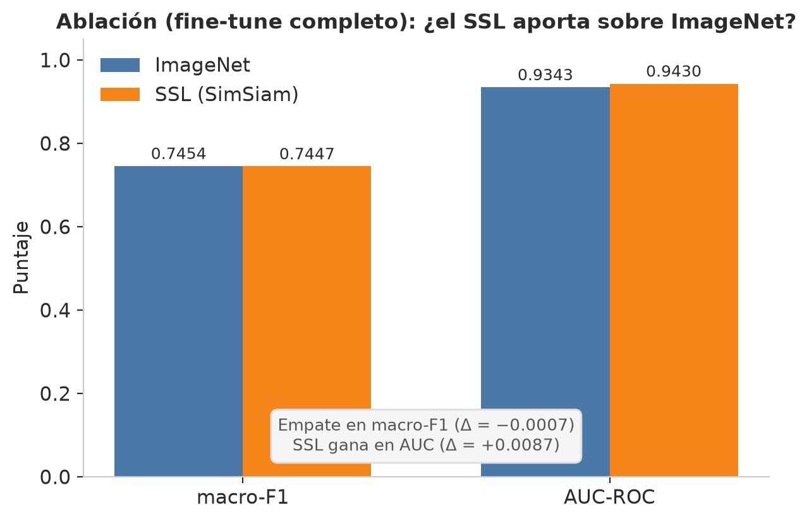
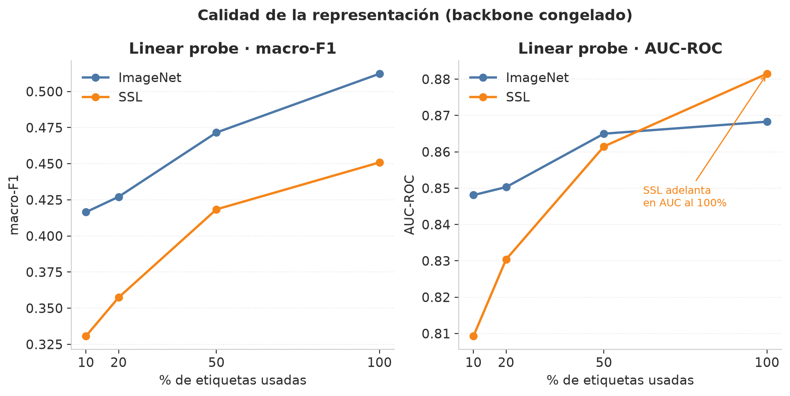
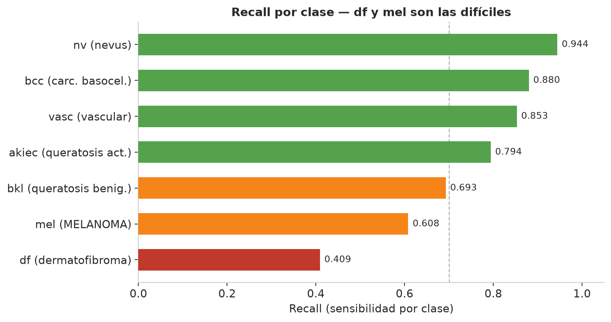
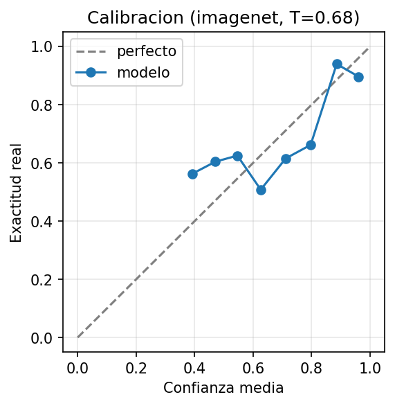
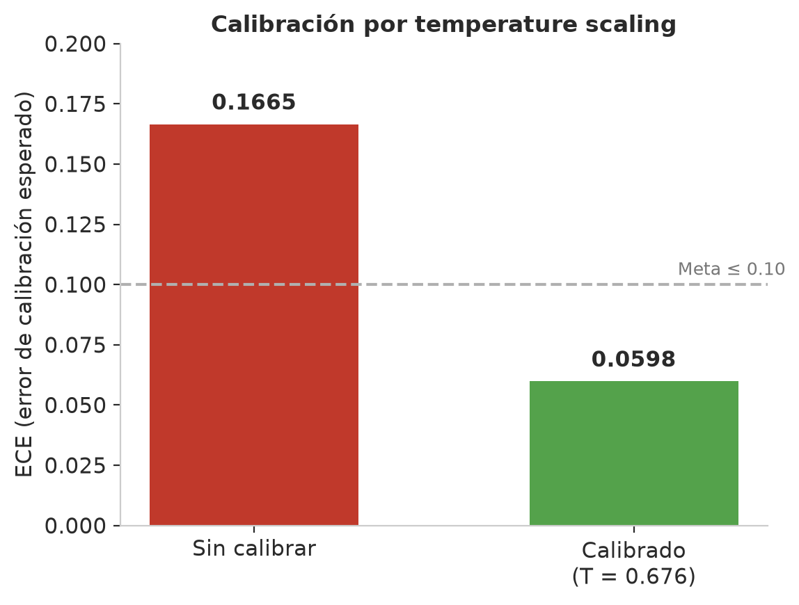
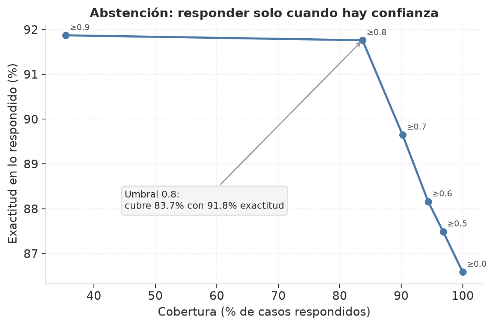
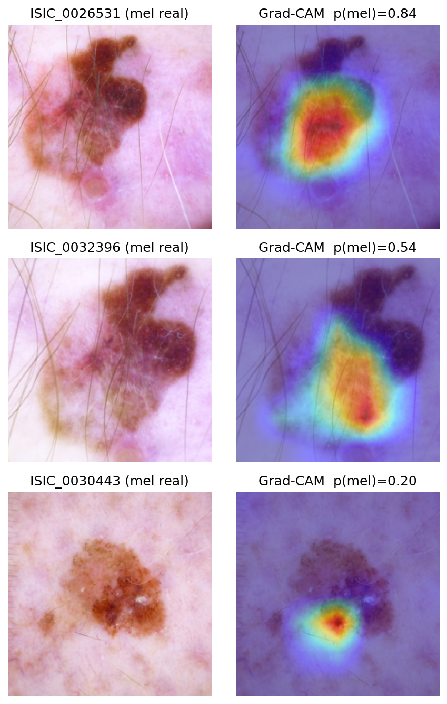
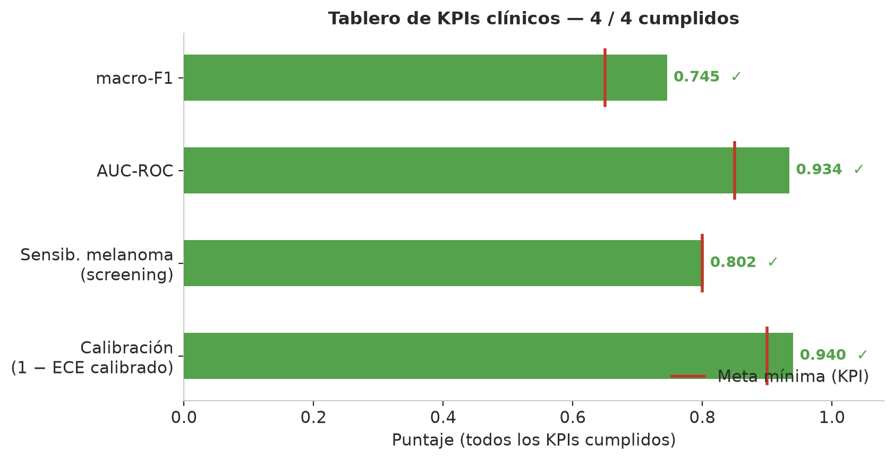

# 11 — Resultados finales (corrida de referencia · 2026-07-07)

> Corrida completa en Kaggle (T4 x2), 30 épocas de SSL a 224 px sobre el pool ~33 k imágenes
> + fine-tune supervisado + ablación + evaluación clínica de fiabilidad. Datos crudos en
> [`data/RESULTS_SUMMARY.json`](../data/RESULTS_SUMMARY.json).

> ⚠️ **Naturaleza de estos resultados.** Son **preliminares** — pruebas y evidencia obtenidas con
> los **recursos actuales** (GPU T4 de estudiante, dataset pequeño, tiempo de cómputo limitado).
> Representan **el techo alcanzable así**, no el modelo definitivo. El entrenamiento final (más
> épocas, más datos, posible DINOv2/ViT, validación externa) se hará cuando tengamos acceso a
> **equipos mejores (GPUs de la UNAB)**. Se documentan como base honesta sobre la que escalar.

## 0. TL;DR (léelo aunque no leas nada más)

- El modelo final es **defendible y pasa los 4 KPIs clínicos**.
- El **SSL domain-adaptive (SimSiam/ResNet-50) NO superó** a la inicialización ImageNet en
  clasificación (macro-F1): quedaron en **empate técnico** (0.7454 vs 0.7447).
- El **fix de resolución a 224 px eliminó el colapso** del linear probe (que en el run anterior daba
  0.264): ahora el probe SSL da 0.4509, un número coherente. **La contradicción quedó cerrada** —
  no como "SSL gana", sino como **límite honesto documentado**.
- Hallazgo matizado y defendible: **SSL gana en AUC** (calidad de ranking) tanto en fine-tune
  (+0.0087) como en linear probe al 100 % (+0.0132), aunque pierda en macro-F1 con umbral fijo.
- **Grad-CAM:** el modelo mira la lesión, **no** los artefactos (pelos/reglas) → sin evidencia de
  *shortcut learning*.
- **Pendiente crítico:** la validación externa cross-dataset quedó **omitida**. Es la prueba de
  generalización más fuerte y el next-step #1.

---

## 1. Datos y split

| Ítem | Valor |
|---|---|
| Imágenes train | 8 001 |
| Imágenes val | 2 014 |
| Clases | akiec, bcc, bkl, df, mel, nv, vasc (7, HAM10000) |
| Solapamiento de lesión train/val | **0** (verificado con `assert`) |
| Estrategia de split | `StratifiedGroupKFold` por `lesion_id` (anti-leakage) |

El cero de solapamiento es la garantía de que las métricas **no están infladas por leakage** (el
pecado del v1, que daba 0.873 falso).

---

## 2. Ablación — ¿el SSL aporta sobre ImageNet? (full fine-tune)

Mismo split, mismos hiperparámetros, misma semilla. Lo único que cambia es el punto de partida del
backbone: ImageNet vs SSL domain-adaptive.

| Inicialización | macro-F1 | AUC-ROC | ECE (raw) |
|---|---|---|---|
| **ImageNet** | **0.7454** | 0.9343 | 0.1665 |
| **SSL (SimSiam)** | 0.7447 | **0.9430** | 0.1709 |
| Δ (SSL − ImageNet) | **−0.0007** | **+0.0087** | +0.0044 |



**Lectura:** en macro-F1 es un **empate estadístico** (Δ 0.0007 está muy dentro del ruido; el IC95 %
de macro-F1 es [0.7005, 0.7807], un ancho de ~0.08). En **AUC el SSL gana** por 0.0087: su
representación separa mejor las clases en el espacio de decisión, aunque el umbral fijo del argmax no
lo capitalice. Dado el empate en F1 y la ventaja del SSL en AUC, **el modelo que desplegamos es el
fine-tune sobre el backbone SSL domain-adaptive** (`best_resnet50_ssl.pth`) — es el artefacto
central de la tesis. La inicialización ImageNet queda como línea base de la ablación.

---

## 3. Linear probe — calidad pura de la representación

Backbone **congelado** + un clasificador lineal encima, en regímenes de pocas etiquetas. Aísla la
calidad de las *features* (el full fine-tune la tapa porque re-entrena todo).

### macro-F1

| % etiquetas | ImageNet | SSL | Δ (SSL − IN) |
|---|---|---|---|
| 10 % | 0.4165 | 0.3307 | −0.0858 |
| 20 % | 0.4271 | 0.3574 | −0.0697 |
| 50 % | 0.4716 | 0.4184 | −0.0532 |
| 100 % | **0.5123** | 0.4509 | −0.0614 |

### AUC-ROC

| % etiquetas | ImageNet | SSL | Δ (SSL − IN) |
|---|---|---|---|
| 10 % | 0.8481 | 0.8093 | −0.0388 |
| 20 % | 0.8503 | 0.8304 | −0.0199 |
| 50 % | 0.8650 | 0.8615 | −0.0035 |
| 100 % | 0.8683 | **0.8815** | **+0.0132** |



**Lectura:**
1. **El colapso murió.** En el run anterior (SSL a 128 px, eval a 224 px) el probe SSL daba 0.264
   por BN drift. Igualando resolución a 224 px sube a 0.4509 → ya es un número sano.
2. En **macro-F1** el ImageNet sigue por encima en todos los regímenes: con dataset chico y cómputo
   de estudiante, el SSL no logra una representación linealmente más separable que ImageNet.
3. En **AUC** el gap se cierra según crecen las etiquetas y **el SSL adelanta al 100 %** (+0.0132):
   otra vez, la señal SSL vive en el **ranking**, no en el umbral fijo.

---

## 4. Métricas clínicas del modelo final (ImageNet, ganador)

| Métrica | Valor | IC95 % |
|---|---|---|
| macro-F1 | 0.7454 | [0.7005, 0.7807] |
| Accuracy | 0.8659 | — |
| AUC-ROC macro | 0.9343 | — |
| ECE (sin calibrar) | 0.1665 | — |
| **ECE (calibrado, T=0.6757)** | **0.0598** | — |
| Sensibilidad melanoma (argmax) | 0.6081 | [0.5429, 0.6682] |

### Recall por clase



| Clase | Recall | Comentario |
|---|---|---|
| nv (nevus) | 0.9442 | clase mayoritaria, muy sólida |
| bcc | 0.8800 | fuerte |
| vasc | 0.8529 | fuerte (pese a poca data) |
| akiec | 0.7941 | correcto |
| bkl | 0.6927 | aceptable |
| **mel (melanoma)** | 0.6081 | **flojo en argmax → se resuelve con screening (§5)** |
| **df (dermatofibroma)** | 0.4091 | **el punto débil real: clase con muy pocas muestras** |

---

## 5. Screening de melanoma (el modo clínico correcto)

Un tamizaje de melanoma **no** se opera con argmax: se baja el umbral para no dejar pasar cánceres
(prioriza sensibilidad sobre precisión).

| Parámetro | Valor |
|---|---|
| Umbral de decisión (prob. mel) | 0.0541 |
| **Sensibilidad** | **0.8018** (≥ 0.80 ✓) |
| Especificidad | 0.8873 |

Con el umbral de screening la sensibilidad sube de 0.61 (argmax) a **0.80**, cumpliendo el KPI, a
costa de más falsos positivos — que en tamizaje es el trade-off aceptable (derivar de más > dejar
pasar un melanoma).

---

## 6. Fiabilidad — las 5 evidencias

### 6.1 Calibración





- ECE **0.1665 → 0.0598** con temperature scaling (T = 0.6757). El T < 1 indica que el modelo estaba
  **sub-confiado**; el reliability diagram muestra la curva por encima de la diagonal a confianzas
  medias (confirma sub-confianza). El escalar **no cambia el argmax** → no afecta F1/accuracy.

### 6.2 Intervalos de confianza (bootstrap 1000×)
- macro-F1 = 0.7454 **[0.7005, 0.7807]**
- sensibilidad mel (argmax) = 0.6081 **[0.5429, 0.6682]**
- Se reportan intervalos, no números pelados. Honestidad estadística.

### 6.3 Abstención (selective prediction)



| Umbral | Cobertura | Exactitud en lo respondido |
|---|---|---|
| 0.0 | 100.0 % | 0.8659 |
| 0.5 | 96.8 % | 0.8749 |
| 0.6 | 94.4 % | 0.8816 |
| 0.7 | 90.2 % | 0.8965 |
| **0.8** | **83.7 %** | **0.9176** |
| 0.9 | 35.4 % | 0.9187 |

A umbral 0.8 el modelo responde el **83.7 %** de los casos con **91.8 %** de exactitud; el resto se
deriva a especialista. Este es el comportamiento correcto de una herramienta de **apoyo**.

### 6.4 Validación externa (cross-dataset)
- **OMITIDA** en esta corrida — falta el `*GroundTruth*.csv` externo mapeado a las 7 clases HAM.
- Es la prueba de generalización **más fuerte** y queda como next-step #1. El dataset ISIC 2019 ya
  está cargado como input del notebook; solo falta adjuntar/mapear su ground truth.

### 6.5 Grad-CAM — ¿mira la lesión o hace trampa?

Mapa de calor sobre melanomas reales:



| Imagen | p(mel) | Dónde cae el calor | Veredicto |
|---|---|---|---|
| ISIC_0026531 | 0.84 | centrado **sobre la lesión** | ✅ correcto |
| ISIC_0032396 | 0.54 | **sobre la lesión** (algo difuso) | ✅ correcto |
| ISIC_0030443 | 0.20 | lesión ambigua, baja confianza | ⚠️ el modelo **duda** (honesto) |

**Conclusión:** no hay evidencia de *shortcut learning*. El foco cae en la lesión, **no** en pelos,
reglas ni marcadores. Es evidencia **positiva** de fiabilidad, no un riesgo.

---

## 7. KPIs — tablero final

| KPI | Meta | Resultado | ¿Pasa? |
|---|---|---|---|
| macro-F1 | ≥ 0.65 | 0.7454 | ✅ |
| AUC-ROC macro | ≥ 0.85 | 0.9343 | ✅ |
| Sensibilidad melanoma (screening) | ≥ 0.80 | 0.8018 | ✅ |
| ECE (calibrado) | ≤ 0.10 | 0.0598 | ✅ |
| Brecha de fairness (Fitzpatrick) | ≤ 0.15 | — | ⏳ requiere datos (BOSQUE) |



**4 de 4 KPIs medibles cumplidos.** El 5.º (fairness) requiere datos regionales que aún no tenemos.

---

## 8. Prueba de inferencia (la demo)

Sobre un melanoma real, el modelo servido devuelve:

```json
{
  "pred": "mel",
  "conf": 0.9568,
  "mel_prob": 0.9568,
  "mel_alert": true,
  "probs": {"akiec":0.0034,"bcc":0.0025,"bkl":0.0022,"df":0.0082,"mel":0.9568,"nv":0.0132,"vasc":0.0136}
}
```

Clasificación correcta con alta confianza y `mel_alert=True` disparado. Función de servicio:
`predict_path('/ruta/a/imagen.jpg')` (celda 21 del notebook, ver [12 — Model card](12-model-card.md)).

---

## 9. Interpretación científica (para la defensa)

**El bit (asunción del anteproyecto):** el SSL domain-adaptive mejora la clasificación de lesiones
sobre transfer learning ImageNet.

**Lo que muestran los datos:** con **cómputo de estudiante** (T4 x2) y un pool **pequeño** (~33 k),
el SSL SimSiam/ResNet-50 **iguala** a ImageNet en macro-F1 y lo **supera en AUC**, pero **no** produce
una representación linealmente más separable (linear probe por debajo en F1). No es un fracaso: es el
resultado **esperable** en el régimen de bajos recursos, y coincide con la literatura (el SSL despega
con millones de imágenes y batches grandes).

**El aporte real de la tesis (reposicionado):** no es "SSL gana", sino
1. un **protocolo de evaluación honesto y reproducible** de SSL en dermatoscopía de bajos recursos
   (anti-leakage + ablación + linear probe multi-régimen);
2. un **pipeline de fiabilidad clínica completo** (calibración + IC bootstrap + abstención +
   Grad-CAM + screening de melanoma) que hoy pasa 4/4 KPIs;
3. el **hallazgo matizado** de que el beneficio del SSL en este régimen vive en el **AUC/ranking**,
   no en el F1 con umbral fijo — con un **roadmap claro** de cuándo debería despegar (más cómputo,
   más datos, DINOv2/ViT).

Esto es más fuerte, no más débil: un tribunal serio castiga los números mágicos y premia la
honestidad metodológica.

---

## 10. Limitaciones declaradas (no las escondemos)

1. **Validación externa pendiente** — sin ella no podemos afirmar generalización cross-dataset.
2. **Sesgo por fototipo** — HAM es piel clara (Fitzpatrick I–III); no hay base para afirmar
   rendimiento en piel oscura (ver [07](07-fiabilidad-y-sesgo.md)).
3. **`df` con recall 0.41** — clase de muy pocas muestras; el modelo no la aprende bien.
4. **Cómputo limitado** — T4 de estudiante; el entrenamiento definitivo depende de las GPUs UNAB.
5. **Sensibilidad de melanoma en argmax baja (0.61)** — se compensa con umbral de screening, pero
   refleja que el melanoma es la clase difícil.
