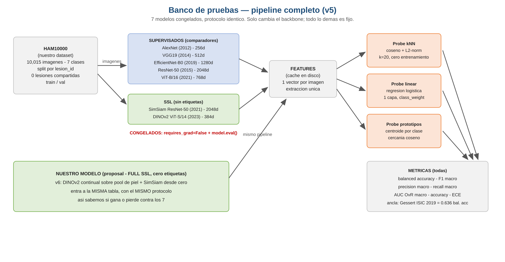
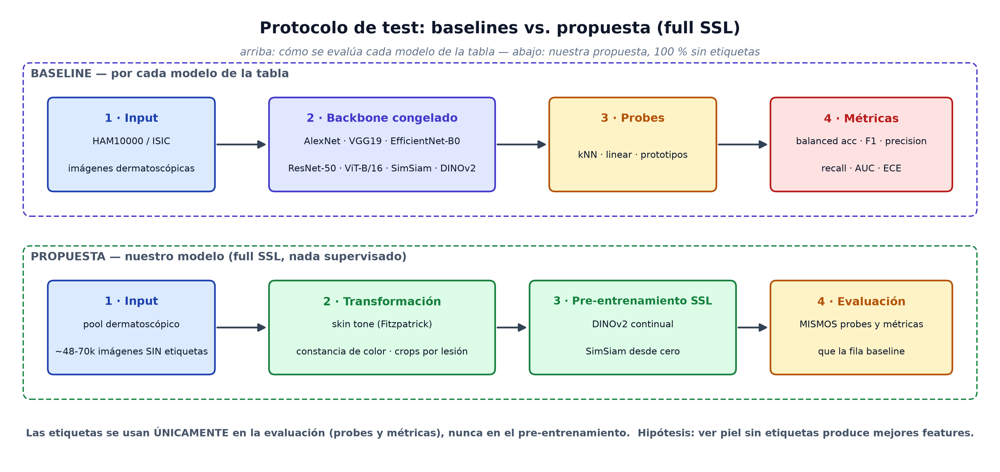
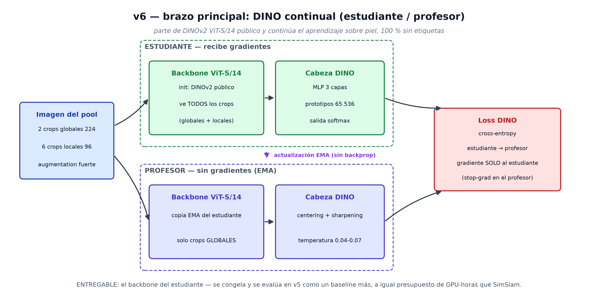
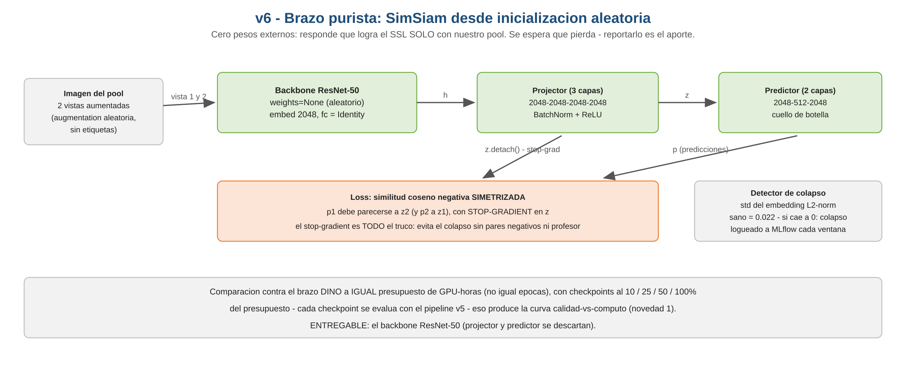

# 18. Estructura visual del pipeline y tests de baseline

Documento visual para el equipo: como funciona el banco de pruebas, como se
testea cada modelo de la tabla oficial, y la estructura interna de las dos
redes de v6. Complementa el documento 17 (fichas de los modelos) y responde
el pedido de la direccion: "generar estructura y grafica visual de como
funciona el notebook" + "generar los tests de cada uno de los modelos".

## 1. Pipeline completo del banco de pruebas

Los siete modelos entran congelados al mismo mecanismo: extraccion de
features sobre HAM10000 (split por `lesion_id`, cero fuga), tres probes
(kNN, regresion logistica, prototipos) y todas las metricas de literatura
(accuracy, balanced accuracy, F1 macro, precision macro, recall macro,
AUC OvR macro, ECE). Nuestro modelo (full SSL) entra despues a la misma
tabla con el mismo protocolo.

## 2. Test de baseline vs proposal

Flujo de cada test de baseline (Input -> Classifier congelado -> Output ->
metricas) y flujo del proposal (Input sin etiquetas -> Transformation Skin
Tone -> Pre-entrenamiento SSL -> Output). El metodo propuesto es SimSiam
sobre DINOv2 (`simsiam_dinov2`); DINO continual y los brazos desde cero son
la comparacion (doc 16, seccion 2). La invariante: el proposal es 100%
auto-supervisado; las etiquetas existen unicamente en la evaluacion.

## 3. Estructura de la red v6 - brazo principal (DINO continual)

Estudiante y profesor comparten arquitectura (DINOv2 ViT-S/14 + cabeza DINO
384-2048-2048-256 con prototipos 4096). Solo el estudiante recibe gradientes;
el profesor es un EMA del estudiante con centering + sharpening (la receta
DINO contra el colapso). El entregable es el backbone del estudiante.

## 4. Estructura de la red v6 - metodo propuesto (SimSiam sobre DINOv2)

El metodo propuesto de la tesis: backbone DINOv2 ViT-S/14 con los pesos
publicos libres de etiquetas, projector de 3 capas y predictor con cuello de
botella (la receta SimSiam). Loss de coseno negativo simetrizada con
stop-gradient. Se monitorea el indicador de colapso (std del embedding
L2-normalizado) desde la epoca 1 — SimSiam sin teacher-EMA es mas propenso
al colapso que DINO. La ablacion opcional usa la misma estructura con
ResNet-50 aleatorio (cero pesos externos); el brazo `dino_scratch` usa la
estructura de la figura 9 con init aleatoria (doc 16, seccion 2).

## 5. Tests por modelo, listos para Kaggle

Carpeta `notebooks/baselines/` — un notebook autocontenido por modelo,
generados por `scripts/build_baseline_tests.py` (protocolo identico
garantizado por construccion). Instrucciones de ejecucion en
`notebooks/baselines/README.md`.

| Modelo | Notebook |
|---|---|
| AlexNet | `notebooks/baselines/alexnet/test_alexnet.ipynb` |
| VGG19 | `notebooks/baselines/vgg19/test_vgg19.ipynb` |
| EfficientNet-B0 | `notebooks/baselines/efficientnet_b0/test_efficientnet_b0.ipynb` |
| ResNet-50 | `notebooks/baselines/resnet50/test_resnet50.ipynb` |
| ViT-B/16 | `notebooks/baselines/vit_b16/test_vit_b16.ipynb` |
| SimSiam ResNet-50 | `notebooks/baselines/simsiam_r50/test_simsiam_r50.ipynb` |
| DINOv2 ViT-S/14 | `notebooks/baselines/dinov2_vits14/test_dinov2_vits14.ipynb` |

## 6. Cambios de codigo que acompanan este documento

- `src/dermssl/metrics.py`: nuevas metricas `precision_per_class`,
  `macro_precision`, `macro_recall`, `balanced_accuracy`; `summarize()` ahora
  devuelve las siete metricas (pedido de la direccion: todas las metricas
  disponibles en literatura).
- `scripts/notebook_code_v5.py`: tres backbones nuevos en el banco
  (`sup_alexnet`, `sup_vgg19`, `sup_effnet_b0`) con extraccion GAP e
  interpolacion por modelo (EfficientNet: BICUBIC).
- `src/dermssl/patch_guard.py`: los tres CNN clasicos registrados sin
  restriccion de parche (el sufijo numerico de `vgg19` no debe disparar la
  heuristica de nombres).
- Suite de tests: 190 en verde (`python -m pytest tests/`).
