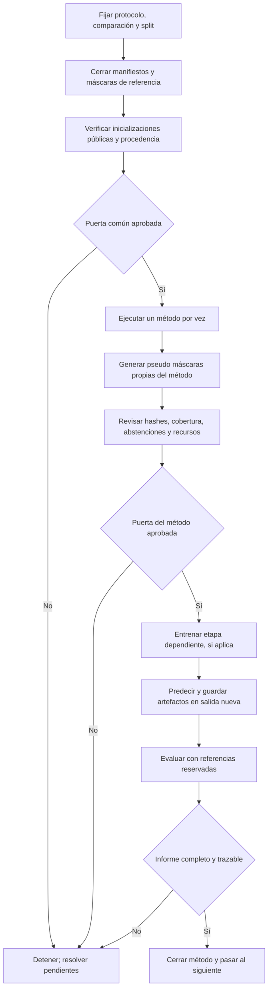

# 45. Flujo de preparación y ejecución de los cuatro métodos V8

Fecha: 2026-10-13. Rama: `experiment/modular-audit-v8`. Estado: preparación; no habilita corridas.

El estado y los cierres específicos por método están en [46. Pendientes por método V8](46-pendientes-por-metodo-v8.md).

Este flujo adapta la ejecución por etapas usada en segmentación V7. Mantiene salidas inmutables, pasos ordenados y parada ante error. No reutiliza checkpoints, bancos SSL, pseudo máscaras ni resultados entrenados por el proyecto en V7. Cada método empieza con pesos aleatorios cuando su protocolo no requiere inicialización externa y usa únicamente checkpoints públicos originales cuando su receta sí los requiere.

## Flujo de V7 que sirve de referencia

El driver `plan-segmentacion/camino-b-cnn/entrenamiento/run_pipeline.py` construye y ejecuta etapas en orden; detiene la cadena si una etapa termina con error. El flujo de segmentación documentado es:

`env → cache → contrastive/MoCo → CCAM → pseudo_r0 → student_r1 → pseudo_r1 → student_r2 → pseudo_r2 → student_r3 → FST → evaluación`.

Las máscaras de referencia entran únicamente en evaluación. W&B acompaña las etapas de contraste, CCAM, estudiante y evaluación. La corrida de clasificación de V7 es otra línea y su launcher/checkpoints no se trasladan a V8.

V8 conserva la idea de ejecución secuencial y usa `scripts/run_segmentation_v8.py` para las etapas, coordinadas por `scripts/run_segmentation_controller_v8.py` a partir de un plan explícito. No se debe invocar el launcher V7.

## Flujo V8 propuesto



### 0. Fijar la comparación antes de ver métricas

Registrar en el protocolo V8:
- La comparación primaria usa el mismo conjunto de evaluación reservado para las máscaras directas de SLED y las predicciones finales de USL-Net y RPI-Net.
- TriDermNet-HAGO se presenta como la adaptación dependiente **SLED→TriDermNet-HAGO**; se informan por separado la salida de SLED y la predicción final de TriDerm.
- Para todos se congelan manifiesto elegible, resolución, preprocesamiento, regla de incertidumbre, métricas, denominador y tratamiento de abstenciones. La cobertura y calidad de pseudo máscaras se reporta por separado de las métricas finales de segmentación.
- Las máscaras expertas y diagnósticos se usan solo en la evaluación independiente; no ajustan umbrales, hiperparámetros ni selección de checkpoints.
- Se registran los módulos entrenados desde cero y los pesos públicos usados por método.

Así se distingue una salida directa sin entrenamiento (SLED), dos segmentadores con sus pseudo etiquetas de método y la adaptación TriDerm condicionada por SLED.

### 1. Cerrar datos y evaluación

1. Crear/vincular el manifiesto completo de entrenamiento con IDs únicos, SHA-256 de cada original y exclusiones verificadas.
2. Confirmar la separación por paciente/lesión y que ningún elemento de evaluación aparezca en preentrenamiento, generación de pseudo máscaras o ajuste.
3. Identificar las rutas de las máscaras expertas y reservar una evaluación anatómica independiente. Las máscaras expertas se leen solo en esa etapa.
4. Fijar y verificar presupuesto de almacenamiento. La estimación registrada para V8 es aproximadamente 46,5 GiB para una fuente y 103,8 GiB para cuatro; el límite actual de 4 GiB no alcanza.

La revisión del 13 de octubre verificó integridad y decodificación RGB de 40.896 originales, pero dejó explícitamente pendiente la procedencia de grupos y la reserva anatómica independiente. Esa verificación no sustituye esta puerta.

### 2. Preparar inicializaciones y bancos

Preparar solo las fuentes públicas que cada receta requiera; no usar `salidas/v7`, `salidas/final`, `student_r3`, checkpoints SimSiam adaptados ni pseudo máscaras V7.

| Método | Fuente necesaria según la adaptación V8 |
|---|---|
| SLED | Ningún checkpoint |
| USL-Net | SimCLR, MoCo v1 y MoCo v2 para la fusión/CCAM |
| RPI-Net | MoCo v3, MoCo v2 y DINO original; MoCo v3 aporta dos fuentes (conv1 y CAM) |
| TriDermNet-HAGO | Arquitectura desde cero; no checkpoint público del proyecto |

Para cada checkpoint externo registrar URL/fuente oficial, licencia, arquitectura exacta, preprocesamiento/normalización, SHA-256, conversión reproducible si el formato no coincide, y manifiesto de procedencia. El loader V8 no descarga ni ejecuta código remoto y exige carga estricta; no sustituir DINO original de RPI por DINOv2.

Los bancos pueden prepararse una sola vez y reutilizarse entre métodos únicamente si el hash, la arquitectura y la normalización son exactamente los mismos. Nunca se actualiza el archivo público original durante conversiones.

### 3. Completar la receta y los recursos de cada método

- **SLED:** la configuración primaria está fijada en `correct_all` + `gaussian_corrected`; las variantes `upstream_zero` y `upstream_area` son controles. Falta medir tiempo, RAM y almacenamiento para el manifiesto completo.
- **USL-Net:** configuración V8 fijada en cinco ciclos de 300 épocas. `max_centroid_distance=null` congela la decisión de no filtrar por distancia al centroide; no se elegirá un corte mirando resultados.
- **RPI-Net:** configuración V8 fijada en 50 épocas iniciales y una fase posterior de 30 como adaptación (el paper no fija el número de fases). El plan deberá declarar la actualización de P2 y conservar P1/P3/P4.
- **TriDermNet-HAGO:** arquitectura desde cero, con SLED como maestro no supervisado; no se reutilizan checkpoints ni pesos clasificadores de Nico/V7. Configuración de adaptación: 150 épocas a 224×224 y warmup HAGO de 10 épocas. Esto no reproduce el entrenamiento supervisado del paper. Falta generar y revisar el manifiesto SLED, fijar su SHA-256 en la config y medir presupuesto.

Registrar por método el dispositivo, timeout, RAM, memoria GPU, espacio de salida y reserva. Los probes sintéticos disponibles miden memoria/tiempo de pasos pequeños; no predicen duración del pool completo.

### 4. Ejecutar por método, con puerta entre etapas

La comparación se ejecuta **en serie, un método a la vez**. El inventario guardado el 2026-10-05 registró dos GPU; la disponibilidad actual no está confirmada y los probes no autorizan concurrencia de corridas completas. Para cada método:

1. Verificar config, hashes, W&B online, manifiesto, gate y carpeta de salida nueva.
2. Ejecutar `check`; confirmar método, etapa, manifiesto y presupuesto.
3. Generar los maestros/pseudo máscaras requeridos:
   - SLED: `generate`;
   - USL-Net: `ccam` y luego `generate`; después de cada `fit`/`predict`, usar `refine` antes de iniciar el ciclo siguiente;
   - RPI-Net: `generate` con sus cuatro fuentes y, tras el ajuste inicial, `predict` → `refine` para la fase posterior;
   - TriDermNet-HAGO: ejecutar SLED como maestro, revisar hashes/cobertura y aprobar el manifiesto; congelar su hash en la receta antes de entrenar TriDerm.
4. Inspeccionar manifiesto producido, hashes, cantidad de éxitos/abstenciones, cobertura, salidas y registro W&B. Una abstención no se elimina silenciosamente ni reduce el denominador.
5. Solo si la puerta de esa salida pasa, ejecutar `fit` cuando aplique y luego `predict`.
6. Evaluar con máscaras expertas reservadas, publicar informe y hashes; cerrar el método antes de iniciar el siguiente.

Un error, cambio de manifiesto, fallo de hash, salida parcial o presupuesto excedido detiene la cadena. No se continúa automáticamente con el siguiente método hasta revisar la evidencia del que terminó.

### Recuperación después de una pausa o un crash

El launcher V8 ahora permite reanudar una etapa `fit` de USL-Net, RPI-Net o TriDermNet-HAGO desde el último checkpoint íntegro y expone `refine` como etapa gated separada para USL/RPI. No se reanudan automáticamente las etapas `pretrain`, `ccam`, `generate`, `predict` ni `refine`; una interrupción en ellas conserva la carpeta parcial y exige revisión antes de decidir cómo reiniciar esa etapa en una carpeta nueva. SLED no tiene una etapa `fit`.

En `fit`, el estado atómico `resume.pt` guarda pesos, AdamW, época, cursor y permutación del sampler, métricas parciales, resultados de épocas y RNG de Python, NumPy, CPU y CUDA. También conserva el contador de HAGO. Se escribe al inicio, cada 100 pasos (configurable con `checkpoint_every_steps`), al cierre de época y al recibir SIGTERM/SIGINT en una frontera segura entre lotes. El launcher espera 120 segundos por defecto para que el worker escriba el estado después de una parada ordenada; se puede fijar el margen con `resources.shutdown_grace_seconds`. Un corte abrupto puede repetir como máximo los lotes procesados desde el último guardado; si el proceso cae mientras escribe, el checkpoint anterior permanece íntegro.

Antes de abrir W&B, `--resume` comprueba que el nombre de salida conserva el mismo run ID. El trainer rechaza el estado si cambió la revisión o los hashes de archivos fuente, método/arquitectura, configuración, gate, manifiesto, inicialización o run ID de W&B. No descarga pesos ni consulta V7. La carpeta anterior y sus artefactos se preservan.

Uso, después de inspeccionar logs y resolver la causa de la parada:

```bash
python scripts/run_segmentation_v8.py --method <metodo> --stage fit \
  --config <config.json> --manifest <manifiesto.json> --gate <gate.json> \
  --out <misma-carpeta-de-salida> --wandb-project <proyecto> --resume
```

La opción solo está habilitada para `fit`; no se debe borrar `resume.pt`, renombrar la carpeta, cambiar la receta ni modificar la procedencia para forzar una continuación. Si los hashes no coinciden o falta el estado, se detiene y se abre una nueva ejecución desde la etapa afectada tras revisar la evidencia.

El controlador serial ya mantiene un ledger, omite pasos completos solo si coinciden sus hashes e identidades y puede recorrer ciclos/fases enumerados en el plan. Puede recuperar `fit` desde `resume.pt`; no reanuda automáticamente `pretrain/ccam/generate/predict/refine` parciales ni inventa gates o el plan científico. La política sigue siendo detener → inspeccionar → corregir → reanudar un `fit` compatible o reiniciar la etapa fallida en salida nueva → verificar antes de continuar. El entrenamiento real permanece deshabilitado hasta cerrar las puertas de la sección siguiente.

### Puertas obligatorias para habilitar ejecución real

Por método y por etapa, la evidencia debe coincidir con el SHA del manifiesto e indicar: datos verificados, grupos/exclusiones confirmados, banco y procedencia verificados cuando corresponda, presupuesto medido, smoke aprobado, revisión de código y evaluación anatómica independiente resuelta. Para entrenamiento, todos los campos exigidos por `common/training.py::gate_report` deben ser verdaderos. Después se actualizan configs y gates juntos; no se cambia `execution_enabled` aisladamente.

Las configuraciones mantienen `execution_enabled=false`, `device=cpu`, `batch_size=2` y `max_output_mb=4096` como bloqueos/valores provisionales; el presupuesto de épocas ya está especificado por método en esta sección. Los bancos y hashes de checkpoints/manifiestos siguen pendientes donde aplican. Estos valores de recursos no describen una corrida completa. W&B debe quedar online y con el proyecto acordado; la entrega de notificaciones se confirma aparte.

## Evidencia ya disponible y límites

La rama registra las comprobaciones sintéticas y probes acotados, además de la corrección del backward determinista de RPI en CUDA. Estos verifican componentes y recursos pequeños; no demuestran eficacia anatómica ni habilitan el entrenamiento sobre todos los datos. Este documento tampoco inicia pruebas ni corridas.
