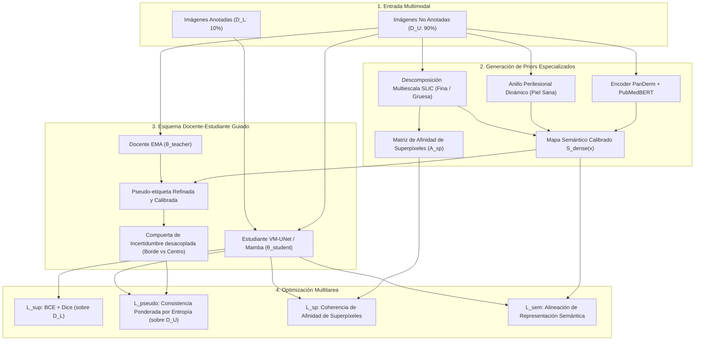

# Propuesta Arquitectónica: Derm-TriplePrior — Segmentación Semisupervisada de Lesiones Cutáneas con Guía Multimodal Especializada y Afinidad Morfológica Diferenciable

**Fecha:** 2026-10-24  
**Versión:** 1.0 (Diseño de Contribución Propia)  
**Autores:** Nicolás Santiago Moreno Monroy, María Paula Saavedra  
**Directores / Asesores:** Andrés Jerez, Karen Sánchez (KAUST)  
**Marco Metodológico:** CRISP-ML(Q) — Fase 3 (Modeling) y Fase 4 (Evaluation)  

---

## 1. Justificación y Definición del Aporte Científico

### 1.1 El Vacío en la Literatura Actual (2023–2026)
Los enfoques semisupervisados recientes (UAMT, MIRA-U, Semi-Mamba-UNet, DME-FD) operan bajo el paradigma de coherencia Docente-Estudiante (*Teacher-Student*). Sin embargo, presentan dos limitaciones fundamentales:
1. **Pérdida de Información en Bordes por Filtrado de Incertidumbre:** Al penalizar o descartar pseudo-etiquetas con alta entropía de Shannon, se omiten sistemáticamente los bordes irregulares de la lesión cutánea (criterio 'B' de la regla ABCD de dermatoscopia), produciendo máscaras sobre-suavizadas o infladas.
2. **Desconexión entre Modelos Fundacionales y la Morfología Local:** Modelos como MedSAM o BiomedCLIP son ajenos a la ontología dermatoscópica o carecen de resolución de contorno denso, mientras que técnicas de superpíxeles (SLIC) se aplican solo de forma heurística como post-procesamiento desacoplado del gradiente.

### 1.2 La Contribución de Esta Propuesta ("Derm-TriplePrior")
A diferencia de TiSage (diseñado para patología general con MedSigLIP y filtrado SLIC desconectado del entrenamiento), **Derm-TriplePrior** unifica tres fuentes de inducción:
* **Prior Semántico Dermatoscópico Adaptado al Paciente:** Extracción densa con DermLIP/PanDerm (2M de imágenes dermatológicas), normalizada contra un anillo perilesional dinámico de piel sana para lograr invarianza al fototipo cutáneo (Fitzpatrick).
* **Prior Estructural Diferenciable ($\mathcal{L}_{\text{sp}}$):** La coherencia morfológica de superpíxeles SLIC se integra directamente en la función de pérdida del estudiante mediante afinidad de grafos, forzando la adhesión a los bordes morfológicos reales durante la retropropagación.
* **Estudiante Ligero de Alta Resolución (VM-UNet / Mamba Bidireccional):** Modelado de contexto global con complejidad computacional lineal $\mathcal{O}(N)$, ideal para imágenes de 512×512 sin cuello de botella de memoria.

---

## 2. Diagrama Arquitectónico

---

## 3. Formulación Matemática de Pérdidas

La optimización global del estudiante minimiza la siguiente combinación lineal:

$$\mathcal{L}_{\text{total}} = \mathcal{L}_{\text{sup}}(\mathcal{D}_L) + \lambda_1 \mathcal{L}_{\text{pseudo}}(\mathcal{D}_U) + \lambda_2 \mathcal{L}_{\text{sp}}(\mathcal{D}_U) + \lambda_3 \mathcal{L}_{\text{sem}}(\mathcal{D}_U)$$

### 3.1 Pérdida Supervisada ($\mathcal{L}_{\text{sup}}$)
Aplicada sobre el subconjunto anotado $\mathcal{D}_L$ (10% de etiquetas):
$$\mathcal{L}_{\text{sup}} = \mathcal{L}_{\text{BCE}}(p_{\text{student}}(x_l), y_l) + \mathcal{L}_{\text{Dice}}(p_{\text{student}}(x_l), y_l)$$

### 3.2 Consistencia No Supervisada con Compuerta de Incertidumbre ($\mathcal{L}_{\text{pseudo}}$)
Para la vista fuertemente perturbada $x_u^s$:
$$\mathcal{L}_{\text{pseudo}} = \frac{1}{|\mathcal{D}_U|} \sum_{x \in \mathcal{D}_U} \frac{1}{HW} \sum_{i,j} \exp\left(-\frac{H(\hat{y}_{\text{fused}}(x_u^w)_{i,j})}{\kappa}\right) \cdot \ell_{\text{BCE}}\left(p_{\text{student}}(x_u^s)_{i,j}, \mathbb{I}(\hat{y}_{\text{fused}} > 0.5)\right)$$
donde $\kappa = \ln(2)$ y $\hat{y}_{\text{fused}} = \sigma(z_{\text{teacher}} + \gamma z_{\text{dermlip}})$.

### 3.3 Pérdida de Coherencia de Superpíxeles ($\mathcal{L}_{\text{sp}}$) — *Aporte Propio*
Fuerza que los píxeles agrupados bajo el mismo superpíxel compartan la misma probabilidad de predicción, evitando bordes dentados y respetando límites naturales:
$$\mathcal{L}_{\text{sp}} = \frac{1}{K} \sum_{k=1}^K \frac{1}{|S_k|^2} \sum_{u, v \in S_k} \left| p_{\text{student}}(u) - p_{\text{student}}(v) \right|^2$$

### 3.4 Pérdida de Alineación Semántica por Paciente ($\mathcal{L}_{\text{sem}}$) — *Aporte Propio*
Maximiza la similitud coseno entre las características densas del estudiante $F_{\text{student}}(x)$ y la proyección normalizada contra el anillo perilesional del paciente:
$$\mathcal{L}_{\text{sem}} = 1 - \frac{1}{HW} \sum_{i,j} \cos\left( F_{\text{student}}(i,j), E_{\text{dense}}(i,j) - E_{\text{ring}} \right)$$

---

## 4. Plan de Ablación y Comparativa Experimental

Para aislar formalmente el impacto de cada contribución, se define el siguiente protocolo experimental sobre **ISIC 2018 Task 1** y **PH2** bajo régimen de 10% de etiquetas:

| Variante Experimental | Backbone Estudiante | Guía VLM | Superpíxeles (SLIC) | Pérdida de Afinidad ($\mathcal{L}_{\text{sp}}$) | Objetivo de la Comparación |
| :--- | :--- | :--- | :--- | :--- | :--- |
| **V0: Baseline Supervisado** | U-Net / ViT | Ninguna | Ninguno | No | Límite inferior sin SSL |
| **V1: TiSage Original** | U-Net | MedSigLIP | Post-hoc estático | No | Reproducción referencial de literatura (Karen Sánchez) |
| **V2: DermLIP-SLIC (Actual)** | ViT / U-Net | DermLIP (PanDerm) | Post-hoc estático | No | Beneficio de la especialización dermatoscópica |
| **V3: Derm-TriplePrior (Propuesta)** | VM-UNet (Mamba) | DermLIP + Anillo Piel | En entrenamiento | **Sí ($\mathcal{L}_{\text{sp}}$)** | **Brazo propuesto completo de la tesis** |

### Métricas de Evaluación Obligatorias
1. **Overlap Anatómico:** Mean Dice (DSC) y Mean Jaccard (IoU).
2. **Precisión de Contorno Clínico:** Distancia de Hausdorff al 95% (HD95 en píxeles).
3. **Robustez a Falsos Positivos:** Sensibilidad, Especificidad (meta $>95\%$) y número de casos rescatados con Dice cero.
4. **Pruebas de Significancia:** Paired bootstrap con 1.000 remuestreos (IC 95%, valor $p$).
