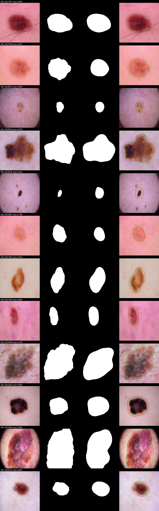
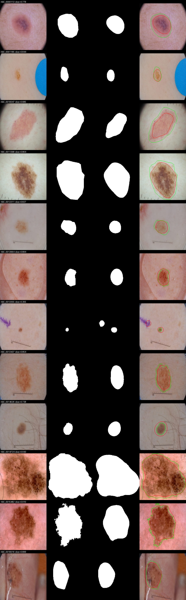
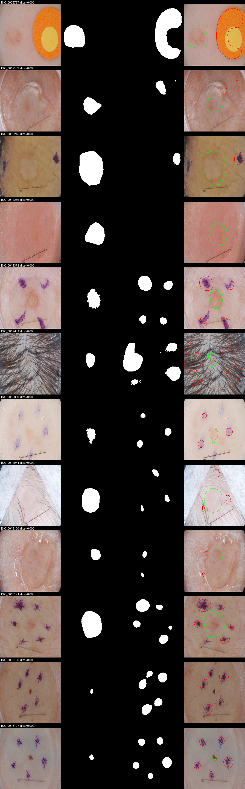
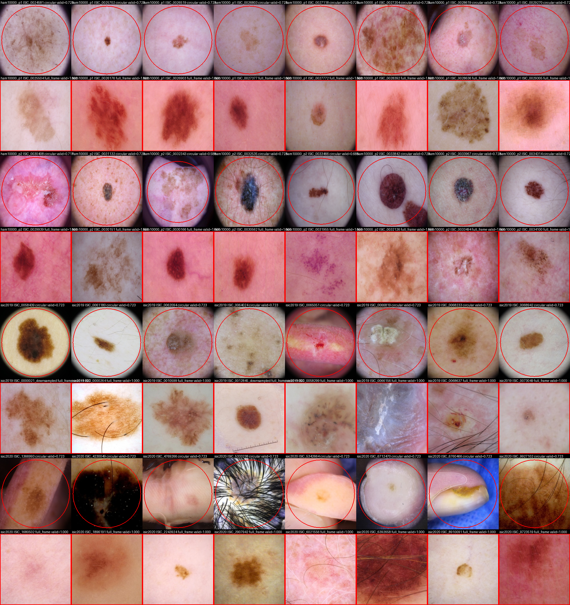

# Resultados del camino B (segmentacion sin mascaras ni etiquetas)

Cada corrida vive en una carpeta `<fecha>-<nombre>` con artefactos livianos:
`resultados.md`, los `summary.json` y `per_image.csv` de cada conjunto de
evaluacion, los overlays PNG (peores, mejores y aleatorios), la hoja de
contacto del campo, los `*_stats.json` de la cache y de las pseudo-mascaras,
un resumen de conteos del manifiesto FST, el log de la corrida y la bitacora.
Nunca la cache, los checkpoints, `field.npy` ni el manifiesto FST completo
(115 MB), que quedan en el NFS del cluster (`~/work/proyectonp/salidas/`).

## Protocolo comun a todas las filas

- Entrenamiento sin mascaras ni etiquetas sobre el pool unico de 58 457
  imagenes (HAM10000 10 015, ISIC 2019 sin las de HAM 15 316, ISIC 2020 33 126;
  deduplicado por id, 2 % reservado como pseudo-validacion).
- Las mascaras de referencia entran solo en la etapa `evaluate`: ISIC 2018
  Task 1 (2 594) y HAM10000 (10 015, mascaras de Tschandl). Umbral fijo 0,5,
  metricas por imagen a 224 x 224: Dice medio con intervalo bootstrap del 95 %
  (1 000 remuestreos, semilla fija), mediana, percentiles, IoU, sensibilidad,
  especificidad, Hausdorff-95 en la corrida final, cobertura predicha y de
  referencia, peores ids.
- ISIC 2018 se reporta ademas en dos filas: ids dentro del pool de
  entrenamiento por la deduplicacion (transductivo, 722) y fuera del pool
  (1 872).
- Estratificacion por fototipo (ITA sobre la pseudo-mascara y el campo, cortes
  de Groh) con `min_n` 30 por bucket. Solo HAM10000 tiene buckets poblados.
- Pisos no supervisados con el mismo evaluador: SegRNorm y SegXNorm
  (`scripts/run_segnorm_baseline.py`, ROI circular, `--max-side 1024`). No hay
  techo supervisado por decision del proyecto.
- Toda cifra cita el commit, el preset y el grupo de Weights & Biases del que
  sale. Proyecto: `nmoreno534-universidad-autonoma-de-bucaramanga/dermssl-segmentacion`.
- Hardware: dos NVIDIA RTX PRO 4000 de 24 GB en el pod UNABIA, DDP con
  `torchrun`, bf16.

## Como se ven las mascaras

Cada rejilla muestra, por fila, la imagen, la mascara de referencia, la mascara
predicha y la superposicion (verde: referencia; rojo: prediccion) con el Dice
de esa imagen en la etiqueta. Son muestras aleatorias, no las mejores.

Corrida final, HAM10000, muestra aleatoria:

Corrida final, ISIC 2018, muestra aleatoria:

Los peores casos de la corrida final en ISIC 2018 (Dice 0): tinta quirurgica
violeta, cabello denso, gel, reglas y brillos con lesiones palidas:

Los mejores casos, para calibrar el ojo: `2026-09-21-final/evaluacion_*/overlays/best.png`.
Para comparar con lo que hacia la V2 de la rama (mascara sobre todo el campo
del dermatoscopio), el piloto y el final se ven en `2026-09-20-piloto/` y los
pisos sin aprendizaje en `2026-09-21-final/baselines_v2/`.

Deteccion del campo del dermatoscopio (borde rojo = limite del campo valido;
una fila por dataset y por tipo, circular o cuadro completo):

## Parametros exactos de la corrida final

Preset `plan-segmentacion/comun/configs/cluster-final.json`, commit `d81a492`,
semilla 42, dos GPU con `torchrun`, bf16.

| Etapa | Parametros |
|---|---|
| Cache | 224 x 224, 2 % de pseudo-validacion, campo del dermatoscopio con umbral minimo 0,06 y margen 0,04 |
| Contrastivo (MoCo v2) | ResNet-50 desde cero, 30 epocas, batch 128 por GPU, AdamW lr 5e-4, wd 1e-4, warmup 2, cola 16 384, momento 0,999, temperatura 0,2, split-BN 4 |
| CCAM | cabeza 3 x 3 sobre layer3 + layer4 congeladas, 5 epocas, batch 64, lr 1e-3, alpha 0,25 |
| Pseudo-mascaras | fondo < 0,35, lesion > 0,65, ignorar entre medio; region mas central; area minima 0,003 y maxima 0,6 del campo; distancia maxima al centro 0,5; tinta y brillos ignorados |
| Estudiante (U-Net) | 32 canales base (7,8 M parametros), BCE + Dice sobre pixeles confiables, Adam lr 1e-4, warmup 1, batch 32 por GPU, 3 rondas x 20 epocas, checkpoint por perdida de pseudo-validacion |
| Evaluacion | umbral fijo 0,5, 224 x 224, Hausdorff-95, bootstrap de 1 000 remuestreos |

Augmentacion en GPU: recorte aleatorio, volteos, jitter de color fuerte,
escala de grises, desenfoque, viñeta sintetica (p = 0,3), nunca sobre la mascara.

## Corridas

| Corrida | Commit | Preset | Grupo W&B | Duracion | Estado |
|---|---|---|---|---|---|
| piloto | `f19ab56` | `cluster-piloto.json` | `piloto` | 37,4 min | terminada 2026-09-21 |
| final | `d81a492` | `cluster-final.json` | `final` | 2 h 35 min | terminada 2026-09-21, configuracion principal |
| v2 | `91814a9` | `cluster-v2.json` | `v2` | 2 h 55 min | terminada 2026-09-21, ablacion negativa |

El piloto uso el detector de campo v1, sin supresion de artefactos y con area
minima de candidato 0,01. El final uso el detector v2, supresion de tinta y
brillos, area minima 0,003, MoCo 30 epocas y tres rondas de re-etiquetado de
20 epocas cada una. El resto de hiperparametros es identico.

## Tabla principal

| Corrida | Conjunto | n | Dice medio [IC 95 %] | Dice mediana | Dice p10 | IoU | Sens. | Espec. | HD95 medio | HD95 mediana |
|---|---|---|---|---|---|---|---|---|---|---|
| final | ISIC 2018 | 2 594 | 0,718 [0,709, 0,726] | 0,792 | 0,402 | 0,602 | 0,783 | 0,973 | 26,1 px | 13,6 px |
| final | HAM10000 | 10 015 | 0,785 [0,781, 0,788] | 0,852 | 0,507 | 0,678 | 0,777 | 0,982 | 22,4 px | 12,6 px |
| piloto | ISIC 2018 | 2 594 | 0,652 [0,643, 0,661] | 0,726 | 0,286 | 0,528 | 0,878 | 0,900 | 38,2 px | 22,9 px |
| piloto | HAM10000 | 10 015 | 0,759 [0,755, 0,762] | 0,810 | 0,509 | 0,638 | 0,896 | 0,911 | - | - |

Los intervalos del piloto se calcularon a posteriori desde `per_image.csv`
con el mismo bootstrap; el HD95 del piloto sobre ISIC 2018 viene de una
evaluacion aparte con `--hausdorff`.

## Pisos no supervisados

SegRNorm (`rnorm`) y SegXNorm (`xnorm`): normalizacion de color y umbral de
Otsu dentro del campo circular, sin aprendizaje, en CPU, con `--max-side 1024`.
Mismo evaluador, mismas imagenes, mismas mascaras de referencia. Artefactos en
`2026-09-21-final/baselines_v2/`.

| Metodo | Conjunto | Dice medio [IC 95 %] | Dice mediana | Dice p10 | IoU | Sens. | Espec. | HD95 medio |
|---|---|---|---|---|---|---|---|---|
| estudiante final | ISIC 2018 | 0,718 [0,709, 0,726] | 0,792 | 0,402 | 0,602 | 0,783 | 0,973 | 26,1 px |
| rnorm | ISIC 2018 | 0,716 [0,707, 0,724] | 0,789 | 0,348 | 0,600 | 0,722 | 0,961 | 33,5 px |
| xnorm | ISIC 2018 | 0,695 [0,687, 0,704] | 0,768 | 0,318 | 0,575 | 0,686 | 0,963 | 33,1 px |
| estudiante final | HAM10000 | 0,785 [0,781, 0,788] | 0,852 | 0,507 | 0,678 | 0,777 | 0,982 | 22,4 px |
| rnorm | HAM10000 | 0,765 [0,762, 0,768] | 0,819 | 0,530 | 0,645 | 0,684 | 0,983 | 22,7 px |
| xnorm | HAM10000 | 0,733 [0,729, 0,736] | 0,788 | 0,485 | 0,604 | 0,636 | 0,985 | 23,0 px |

Comparacion pareada por imagen (bootstrap de la diferencia estudiante menos
piso, 5 000 remuestreos, semilla fija; el script del cluster con 10 000
remuestreos da los mismos intervalos a la tercera cifra):

| Diferencia | Dice | HD95 |
|---|---|---|
| ISIC 2018, estudiante menos rnorm | +0,002 [-0,007, +0,011], empate | -7,4 px [-8,6, -6,1], gana el estudiante |
| ISIC 2018, estudiante menos xnorm | +0,022 [+0,013, +0,032], gana el estudiante | -7,0 px [-8,2, -5,7], gana el estudiante |
| HAM10000, estudiante menos rnorm | +0,020 [+0,016, +0,023], gana el estudiante | -0,2 px [-0,7, +0,3], empate |
| HAM10000, estudiante menos xnorm | +0,052 [+0,049, +0,056], gana el estudiante | -0,5 px [-1,0, 0,0], gana por poco |

Lectura honesta: en ISIC 2018 el metodo aprendido no mejora el solapamiento
medio frente a rnorm, pero produce bordes mejores (7 px menos de HD95) y menos
fallos catastroficos (p10 0,40 frente a 0,35); en HAM10000 mejora el
solapamiento y empata en bordes. Contra xnorm gana en todo. El unico indicador
en que un piso supera al estudiante es el p10 de HAM10000 (rnorm 0,530 frente a
0,507). "Supera a los pisos" a secas seria una afirmacion incorrecta.

Piloto frente a final, pareado: +0,066 [+0,059, +0,072] en ISIC 2018 y
+0,026 [+0,023, +0,029] en HAM10000; ambos excluyen el cero.

## Dentro y fuera del pool de entrenamiento

| Corrida | Conjunto | En el pool (n) | Dice | Fuera del pool (n) | Dice |
|---|---|---|---|---|---|
| final | ISIC 2018 | 722 | 0,801 | 1 872 | 0,686 |
| final | HAM10000 | 9 822 | 0,786 | 193 | 0,703 |

La cifra honesta de generalizacion en ISIC 2018 es la de fuera del pool:
0,686. La diferencia con la fila transductiva es la ganancia de haber visto la
imagen, sin su mascara, durante el entrenamiento.

## Fototipo (HAM10000)

| Bucket | n | Dice piloto | Dice final |
|---|---|---|---|
| 1 | 5 729 | 0,781 | 0,791 |
| 2 | 473 | 0,794 | 0,791 |
| 3 | 121 | 0,758 | 0,765 |
| 4 | 42 | 0,770 | 0,780 |
| 6 | 3 431 | 0,730 | 0,780 |
| brecha maximo - minimo | | 0,071 | 0,027 |

El bucket 5 (n = 26) queda bajo `min_n` y no se reporta. Los buckets salen del
estimador ITA sobre la pseudo-mascara, que la validacion externa mostro por
debajo de la linea base trivial en Fitzpatrick17k; leer la brecha como un
indicio, no como una medida de equidad validada.

## Tamano de la lesion

Dice medio por banda de cobertura de referencia:

| Cobertura de la lesion | ISIC 2018 piloto | ISIC 2018 final | HAM piloto | HAM final |
|---|---|---|---|---|
| menos del 10 % | 0,464 | 0,646 | 0,556 | 0,750 |
| 10 % a 25 % | 0,749 | 0,793 | 0,786 | 0,850 |
| 25 % a 40 % | 0,811 | 0,782 | 0,834 | 0,794 |
| 40 % a 60 % | 0,806 | 0,733 | 0,825 | 0,724 |
| 60 % o mas | 0,801 | 0,684 | 0,802 | 0,642 |

El area minima de candidato 0,003 resolvio las lesiones pequenas (41 % de
ISIC 2018) y la correlacion Dice-tamano paso de +0,52 a +0,11 en ISIC 2018 y
de +0,40 a -0,20 en HAM10000. El cuello de botella se movio a las lesiones
grandes: el cap de area de candidato (0,6 del campo) excluye del entrenamiento
las lesiones que llenan el cuadro, y el estudiante las subsegmenta (cobertura
predicha 0,17 frente a 0,21 de referencia en ISIC 2018). Es el cambio con mas
retorno para una corrida siguiente: subir el cap a 0,75 manteniendo el resto.

## Diagnostico de la corrida final

- Campo del dermatoscopio (detector v2): 7 528 imagenes circulares y 50 929 de
  cuadro completo, cero fallbacks. Por dataset: ISIC 2020 paso de 1 975 a 129
  circulares (los falsos circulares del piloto eran viñeteo optico de camara),
  HAM10000 de 1 322 a 687, ISIC 2019 de 7 465 a 6 712 (viñetas reales de
  BCN20000). Evidencia visual en `field_contact_sheet.png` de cada corrida.
  El detector inscribe un circulo en la caja de los pixeles claros: cuando el
  campo toca los cuatro bordes del cuadro, ese circulo es el disco inscrito
  (72,3 % del area), que es el caso de 3 863 de las 7 528 imagenes circulares;
  el resto tiene un radio propio, mas pequeno, tipico de los dermatoscopios
  con campo chico.
- Pseudo-mascaras por ronda: excluidas 8,4 % (r0), 4,4 % (r1), 4,3 % (r2);
  fraccion de primer plano 0,131, 0,148, 0,143. El re-etiquetado converge en
  dos rondas y no deriva hacia el campo entero. Tinta y brillos ocupan el
  0,68 % de los pixeles y quedan ignorados en la perdida.
- Modo de fallo restante (`overlays/worst.png`): marcas de tinta violeta,
  cabello denso, gel y reglas siguen atrayendo predicciones aisladas cuando la
  lesion es palida; el estudiante no aprende a rechazarlas porque esos pixeles
  se ignoran en vez de marcarse como fondo.
- Reproducibilidad: 16 etapas con codigo 0, 9 283 s de computo, sin
  reinicios del pod durante la corrida buena. Dos corridas anteriores del
  mismo commit murieron con el pod al convivir con doce procesos de pisos a
  resolucion nativa; la bitacora documenta ambas.

## Ablacion v2: tope de area 0,75 (no mejora)

Un solo cambio de entrenamiento respecto a la configuracion principal:
`pseudo.max_area_fraction` 0,6 a 0,75 (mismas epocas, rondas, seleccion de
checkpoint y umbral). Artefactos en `2026-09-21-v2/`. La cache fue identica
byte a byte a la del final; en las pseudo-mascaras de la ronda 0 entraron
1 087 lesiones grandes mas (excluidas por area 4 252 a 3 165) sin desborde
(primer plano 0,131 a 0,143).

| Conjunto | Dice final | Dice v2 | Pareado v2 menos final (Dice) | Pareado (HD95) |
|---|---|---|---|---|
| ISIC 2018 | 0,718 | 0,716 | -0,0015 [-0,0027, -0,0004], pierde | -0,22 px [-0,58, +0,13], empate |
| HAM10000 | 0,785 | 0,783 | -0,0021 [-0,0026, -0,0017], pierde | +0,17 px [+0,08, +0,27], pierde |

Por banda de cobertura de referencia (Dice medio, final a v2):

| Cobertura | ISIC 2018 | HAM10000 |
|---|---|---|
| menos del 10 % | 0,646 a 0,646 | 0,750 a 0,750 |
| 10 % a 25 % | 0,793 a 0,788 | 0,850 a 0,846 |
| 25 % a 40 % | 0,782 a 0,778 | 0,794 a 0,791 |
| 40 % a 60 % | 0,733 a 0,731 | 0,724 a 0,722 |
| 60 % o mas | 0,684 a 0,695 | 0,642 a 0,647 |

El tope alto hace lo que se diseno (las lesiones grandes mejoran) pero cuesta
unas milesimas en las bandas medias, que pesan cinco o seis veces mas. El
balance neto es una perdida pequena y estadisticamente detectable, asi que la
configuracion principal sigue siendo la final y esta palanca queda cerrada.

## Volteos en inferencia (TTA)

`evaluate_segmentation.py --tta` promedia la prediccion sobre los cuatro
volteos sin tocar el modelo. Sobre la configuracion principal, pareado:
Dice +0,0003 [-0,0002, +0,0007] en ISIC 2018 y +0,0002 [0,0000, +0,0004] en
HAM10000 (empate), HD95 -0,32 px [-0,61, -0,04] y -0,08 px [-0,16, -0,01]
(mejora de borde). Cuesta cuatro veces mas computo en inferencia; se reporta
como opcion, no como valor por defecto. Tampoco rescata la v2 (v2 con volteos
0,7173 frente a 0,7177 del final sin volteos en ISIC 2018).

## Sirve ya como entrada del ITA y de la clasificacion

La mascara se usa aguas abajo para excluir la lesion antes de medir el tono de
la piel (ITA) y, mas adelante, como region de interes del clasificador. Para
eso no hace falta un borde perfecto: hace falta que la lesion quede fuera del
conjunto de pixeles de piel y que las imagenes sin mascara confiable se
detecten. Con la corrida final:

- Mediana de Dice 0,79 (ISIC 2018) y 0,85 (HAM10000); nueve de cada diez
  imagenes superan 0,40 y 0,51 respectivamente.
- La cuarentena funciona: 3 479 de 58 457 imagenes del pool (6 %) quedan sin
  bucket por mascara no elegible, en vez de recibir un ITA inventado.
- El sesgo es hacia subsegmentar (cobertura predicha 0,17 frente a 0,21 de
  referencia en ISIC 2018). Para el ITA eso significa que parte del borde de la
  lesion puede colarse como "piel" y oscurecer la lectura. Mitigacion barata
  antes de usarla: dilatar la mascara unos 8 a 12 pixeles a 224 (o el 5 % del
  lado) al construir el conjunto de piel. `fst_pseudo_manifest.py` ya excluye
  ademas la banda ignorada y el exterior del campo.
- Fototipos: en HAM10000 la brecha de Dice entre buckets es 0,027, con todos
  los buckets poblados entre 0,765 y 0,791. El estimador de buckets es el
  propio ITA sobre la pseudo-mascara y su validacion externa quedo por debajo
  de la linea base trivial, asi que la equidad de la segmentacion se afirma
  con cautela.

Conclusion: es utilizable ya como paso previo del ITA y del clasificador, con
la dilatacion anterior y respetando la cuarentena. Donde no es utilizable sin
revision es en imagenes con tinta, gel o cabello denso: ahi la mascara puede
caer sobre el artefacto y no sobre la lesion.

## Que se puede mejorar y como

Por retorno esperado, todo sin etiquetas:

1. Tope de area de candidato 0,75: probado el 2026-09-21 (corrida v2), no
   mejora; ver la ablacion arriba. Palanca cerrada.
2. Tinta y brillos como fondo en lugar de ignorados. Hoy el estudiante no
   aprende a rechazarlos; marcarlos como fondo lo obliga. Riesgo: si la regla
   de color toca una lesion azulada, la castiga. Verificar con los peores casos.
3. Inferencia con volteos (test-time augmentation) y promedio de las tres
   rondas del estudiante. Suele dar decimas de Dice sin reentrenar.
4. Resolucion 320 en lugar de 224 para lesiones pequenas y bordes; cuesta
   el doble de tiempo por epoca.
5. Piso adicional zero-shot con SAM y prompt central, previsto en el plan,
   para situar el resultado frente a un modelo fundacional sin etiquetas.

Lo que no se hace por decision del proyecto: entrenar con mascaras o usar un
techo supervisado.
